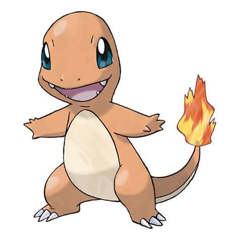
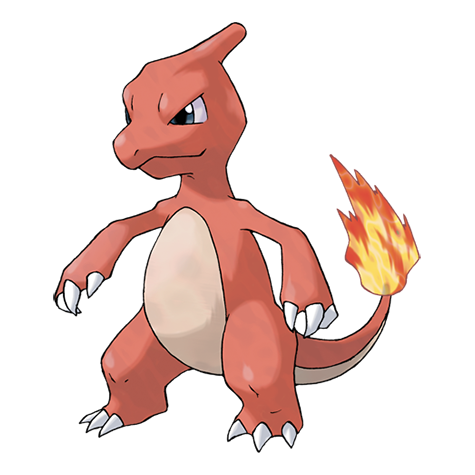
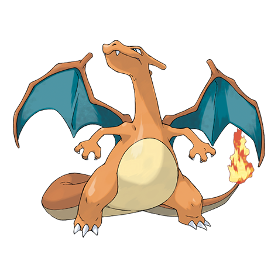

<!-- .slide: class="hero" -->

workshop · acm feup

# Criar uma <em>moeda</em>

Web 3.0, uma nova versão da internet.

  14 OUT · 15:00
  até 16:30
  sala B340, FEUP

Note:

Boas-vindas. Apresentar a WEB3UP e quem está a dar o workshop.
Pedir já a toda a gente que tenha o telemóvel com bateria e o portátil aberto.

---

## Hoje

  
<i>1</i> Web 3.0, uma nova internet?

  
<i>2</i> Criar uma moeda numa plataforma de computação descentralizada

  
<i>3</i> WEB3UP, um playground para falhar ideias

Note:

Três passos, 90 minutos. No fim, cada equipa tem uma moeda a circular na sala.

---

<!-- .slide: class="hero" -->

parte 1 · 5 min

## Web 3.0, uma nova <em>internet</em>?

Note:

Adaptado da apresentação "A New Internet for Digital Products", PBA Lisboa, abril de 2026.

---

  
<svg class="art" viewBox="0 0 200 220"><path d="M28 220c0-48 30-72 72-72s72 24 72 72z" fill="#b060ff"/><rect x="88" y="128" width="24" height="26" fill="#f2c7a5"/><circle cx="100" cy="90" r="52" fill="#f2c7a5"/><path d="M48 86c-2-44 28-60 54-58 32 2 54 24 50 58-10-18-30-28-52-26-22-2-40 8-52 26z" fill="#1f2937"/><circle cx="118" cy="94" r="5" fill="#030712"/><circle cx="84" cy="94" r="5" fill="#030712"/><path d="M88 118q12 10 24 0" stroke="#7a2e2e" stroke-width="4" fill="none" stroke-linecap="round"/></svg>tu

  <svg class="v-arrow own" viewBox="0 0 60 16"><path d="M2 8h56" stroke="currentColor" stroke-width="3"/></svg>
  
<svg class="art" viewBox="0 0 200 176"><g transform="translate(30 80)"><rect width="150" height="78" rx="6" fill="#d8ecd2" stroke="#2f6b3a" stroke-width="2"/><rect x="8" y="8" width="134" height="62" rx="3" fill="none" stroke="#2f6b3a" stroke-width="1"/><circle cx="75" cy="39" r="20" fill="none" stroke="#2f6b3a" stroke-width="2"/><text x="75" y="48" text-anchor="middle" font-family="Georgia, serif" font-size="26" font-weight="700" fill="#2f6b3a">€</text><text x="16" y="28" font-family="Georgia, serif" font-size="16" font-weight="700" fill="#2f6b3a">100</text></g><g transform="translate(22 58)"><rect width="150" height="78" rx="6" fill="#d8ecd2" stroke="#2f6b3a" stroke-width="2"/><rect x="8" y="8" width="134" height="62" rx="3" fill="none" stroke="#2f6b3a" stroke-width="1"/><circle cx="75" cy="39" r="20" fill="none" stroke="#2f6b3a" stroke-width="2"/><text x="75" y="48" text-anchor="middle" font-family="Georgia, serif" font-size="26" font-weight="700" fill="#2f6b3a">€</text><text x="16" y="28" font-family="Georgia, serif" font-size="16" font-weight="700" fill="#2f6b3a">100</text></g><g transform="translate(14 36)"><rect width="150" height="78" rx="6" fill="#d8ecd2" stroke="#2f6b3a" stroke-width="2"/><rect x="8" y="8" width="134" height="62" rx="3" fill="none" stroke="#2f6b3a" stroke-width="1"/><circle cx="75" cy="39" r="20" fill="none" stroke="#2f6b3a" stroke-width="2"/><text x="75" y="48" text-anchor="middle" font-family="Georgia, serif" font-size="26" font-weight="700" fill="#2f6b3a">€</text><text x="16" y="28" font-family="Georgia, serif" font-size="16" font-weight="700" fill="#2f6b3a">100</text></g><g transform="translate(6 14)"><rect width="150" height="78" rx="6" fill="#d8ecd2" stroke="#2f6b3a" stroke-width="2"/><rect x="8" y="8" width="134" height="62" rx="3" fill="none" stroke="#2f6b3a" stroke-width="1"/><circle cx="75" cy="39" r="20" fill="none" stroke="#2f6b3a" stroke-width="2"/><text x="75" y="48" text-anchor="middle" font-family="Georgia, serif" font-size="26" font-weight="700" fill="#2f6b3a">€</text><text x="16" y="28" font-family="Georgia, serif" font-size="16" font-weight="700" fill="#2f6b3a">100</text></g></svg>1 000 €<svg class="art" viewBox="0 0 200 176"><g transform="translate(30 80)"><rect width="150" height="78" rx="6" fill="#f3dfc8" stroke="#8a4b1c" stroke-width="2"/><rect x="8" y="8" width="134" height="62" rx="3" fill="none" stroke="#8a4b1c" stroke-width="1"/><circle cx="75" cy="39" r="20" fill="none" stroke="#8a4b1c" stroke-width="2"/><text x="75" y="48" text-anchor="middle" font-family="Georgia, serif" font-size="26" font-weight="700" fill="#8a4b1c">₽</text><text x="16" y="28" font-family="Georgia, serif" font-size="16" font-weight="700" fill="#8a4b1c">5000</text></g><g transform="translate(22 58)"><rect width="150" height="78" rx="6" fill="#f3dfc8" stroke="#8a4b1c" stroke-width="2"/><rect x="8" y="8" width="134" height="62" rx="3" fill="none" stroke="#8a4b1c" stroke-width="1"/><circle cx="75" cy="39" r="20" fill="none" stroke="#8a4b1c" stroke-width="2"/><text x="75" y="48" text-anchor="middle" font-family="Georgia, serif" font-size="26" font-weight="700" fill="#8a4b1c">₽</text><text x="16" y="28" font-family="Georgia, serif" font-size="16" font-weight="700" fill="#8a4b1c">5000</text></g><g transform="translate(14 36)"><rect width="150" height="78" rx="6" fill="#f3dfc8" stroke="#8a4b1c" stroke-width="2"/><rect x="8" y="8" width="134" height="62" rx="3" fill="none" stroke="#8a4b1c" stroke-width="1"/><circle cx="75" cy="39" r="20" fill="none" stroke="#8a4b1c" stroke-width="2"/><text x="75" y="48" text-anchor="middle" font-family="Georgia, serif" font-size="26" font-weight="700" fill="#8a4b1c">₽</text><text x="16" y="28" font-family="Georgia, serif" font-size="16" font-weight="700" fill="#8a4b1c">5000</text></g><g transform="translate(6 14)"><rect width="150" height="78" rx="6" fill="#f3dfc8" stroke="#8a4b1c" stroke-width="2"/><rect x="8" y="8" width="134" height="62" rx="3" fill="none" stroke="#8a4b1c" stroke-width="1"/><circle cx="75" cy="39" r="20" fill="none" stroke="#8a4b1c" stroke-width="2"/><text x="75" y="48" text-anchor="middle" font-family="Georgia, serif" font-size="26" font-weight="700" fill="#8a4b1c">₽</text><text x="16" y="28" font-family="Georgia, serif" font-size="16" font-weight="700" fill="#8a4b1c">5000</text></g></svg>100 000 ₽

  <svg class="v-arrow to-bank fragment" data-fragment-index="1" viewBox="0 0 216 16"><path d="M2 8h200" stroke="currentColor" stroke-width="3" stroke-dasharray="8 7"/><path d="M202 2l8 6-8 6" fill="none" stroke="currentColor" stroke-width="3" stroke-linejoin="round"/></svg>
  

    
Governo portuguêsKremlin<svg class="fragment fade-out badge" data-fragment-index="5" flag-pt" viewBox="0 0 60 40"><rect width="24" height="40" fill="#046a38"/><rect x="24" width="36" height="40" fill="#da291c"/><circle cx="24" cy="20" r="9" fill="#ffe900"/><circle cx="24" cy="20" r="5" fill="#da291c" stroke="#fff" stroke-width="1.5"/></svg><svg class="fragment badge" data-fragment-index="5" flag-pt" viewBox="0 0 60 40"><rect width="60" height="13.4" fill="#fff"/><rect y="13.3" width="60" height="13.4" fill="#0039a6"/><rect y="26.6" width="60" height="13.4" fill="#d52b1e"/></svg>

    

      
Banco de PortugalBanco Central da Rússia<svg class="fragment fade-out badge" data-fragment-index="5" viewBox="0 0 40 40"><circle cx="20" cy="20" r="17" fill="#1d3f6e"/><text x="20" y="25" text-anchor="middle" font-family="Georgia, serif" font-size="13" font-weight="700" fill="#fff">BdP</text></svg><svg class="fragment badge" data-fragment-index="5" viewBox="0 0 40 40"><circle cx="20" cy="20" r="17" fill="#0039a6"/><text x="20" y="25" text-anchor="middle" font-family="Georgia, serif" font-size="13" font-weight="700" fill="#fff">ЦБ</text></svg>

      
<svg class="art" viewBox="0 0 200 176"><rect x="14" y="40" width="172" height="124" rx="4" fill="#e5e7eb"/><rect x="10" y="26" width="180" height="30" rx="4" fill="#ec0000"/><path d="M38 31c2 3 6 5 6 10 0 2-1 4-3 6 1-3 0-5-2-6-1 2-2 4-4 5 0-2-1-3-2-4-1 2-2 4-1 6-2-1-3-3-3-6 0-5 6-7 9-11z" fill="#fff"/><text x="112" y="47" text-anchor="middle" font-family="Switzer, system-ui, sans-serif" font-size="17" font-weight="700" fill="#fff">Santander</text><rect x="26" y="70" width="58" height="56" rx="2" fill="#9cc3dc"/><path d="M26 104l58-30v12l-58 30z" fill="#fff" opacity="0.35"/><rect x="96" y="70" width="44" height="94" rx="2" fill="#1f2937"/><rect x="100" y="74" width="16" height="86" fill="#9cc3dc"/><rect x="120" y="74" width="16" height="86" fill="#9cc3dc"/><rect x="150" y="80" width="28" height="60" rx="3" fill="#1f2937"/><rect x="155" y="86" width="18" height="14" rx="1" fill="#7dd3fc"/><rect x="155" y="106" width="18" height="3" fill="#ec0000"/><g fill="#9ca3af"><rect x="155" y="113" width="5" height="4"/><rect x="161.5" y="113" width="5" height="4"/><rect x="168" y="113" width="5" height="4"/><rect x="155" y="119" width="5" height="4"/><rect x="161.5" y="119" width="5" height="4"/><rect x="168" y="119" width="5" height="4"/></g><text x="164" y="152" text-anchor="middle" font-family="ui-monospace, monospace" font-size="9" fill="#6b7280">MB</text></svg>Santander<svg class="art" viewBox="0 0 200 176"><rect x="14" y="40" width="172" height="124" rx="4" fill="#e5e7eb"/><rect x="10" y="26" width="180" height="30" rx="4" fill="#21a038"/><circle cx="34" cy="41" r="9" fill="none" stroke="#fff" stroke-width="2.5"/><path d="M29 41l4 4 8-8" fill="none" stroke="#fff" stroke-width="2.5" stroke-linecap="round" stroke-linejoin="round"/><text x="112" y="47" text-anchor="middle" font-family="Switzer, system-ui, sans-serif" font-size="17" font-weight="700" fill="#fff">Sberbank</text><rect x="26" y="70" width="58" height="56" rx="2" fill="#9cc3dc"/><path d="M26 104l58-30v12l-58 30z" fill="#fff" opacity="0.35"/><rect x="96" y="70" width="44" height="94" rx="2" fill="#1f2937"/><rect x="100" y="74" width="16" height="86" fill="#9cc3dc"/><rect x="120" y="74" width="16" height="86" fill="#9cc3dc"/><rect x="150" y="80" width="28" height="60" rx="3" fill="#1f2937"/><rect x="155" y="86" width="18" height="14" rx="1" fill="#7dd3fc"/><rect x="155" y="106" width="18" height="3" fill="#21a038"/><g fill="#9ca3af"><rect x="155" y="113" width="5" height="4"/><rect x="161.5" y="113" width="5" height="4"/><rect x="168" y="113" width="5" height="4"/><rect x="155" y="119" width="5" height="4"/><rect x="161.5" y="119" width="5" height="4"/><rect x="168" y="119" width="5" height="4"/></g></svg>Sberbank

    

  

  
<svg class="v-arrow down" viewBox="0 0 16 56"><path d="M8 2v42" stroke="currentColor" stroke-width="3" stroke-dasharray="8 7"/><path d="M2 42l6 8 6-8" fill="none" stroke="currentColor" stroke-width="3" stroke-linejoin="round"/></svg><svg class="art" viewBox="0 0 200 176"><g transform="translate(0 30)"><rect x="20" y="78" width="160" height="30" rx="15" fill="#2f3324"/><g fill="#6b7350"><circle cx="40" cy="93" r="9"/><circle cx="70" cy="93" r="9"/><circle cx="100" cy="93" r="9"/><circle cx="130" cy="93" r="9"/><circle cx="160" cy="93" r="9"/></g><path d="M28 78l12-20h120l12 20z" fill="#4b5320"/><path d="M70 58l8-20h52l8 20z" fill="#5a6332"/><rect x="128" y="42" width="66" height="7" rx="3" fill="#4b5320"/><circle cx="96" cy="48" r="4" fill="#2f3324"/></g></svg>Forças Armadas

Note:

Adaptado da abertura da Polkadot Blockchain Academy.
Abro um banco digital. Envias-me dinheiro, eu guardo, devolvo quando pedires. Ninguém confia. Publico o código, faço auditorias, reescrevo tudo em Rust. Continua sem clientes.
Porque é que confias no Santander? Ninguém leu o código do Santander.
Tens 1 000 €.
[clique] Guardas no Santander.
[clique] O Santander está dentro das regras do Banco de Portugal, que o supervisiona.
[clique] O Banco de Portugal está dentro das leis do Governo português.
[clique] E, no limite, quem faz cumprir essas leis são as Forças Armadas.
Confiamos em pessoas e instituições, e na hipótese de serem apanhadas se se portarem mal.
[clique] Agora o mesmo num país autocrático. Os 100 000 rublos estão no Sberbank, supervisionado pelo Banco Central da Rússia, que responde ao Kremlin.
A cadeia é igual. A diferença é quem está no topo e se alguém o pode travar.

---v

  

    

    

      
<svg class="xl-logo" viewBox="0 0 32 32"><rect x="8" y="2" width="22" height="28" rx="2" fill="#21a366"/><rect x="19" y="2" width="11" height="9.3" fill="#33c481"/><rect x="19" y="11.3" width="11" height="9.4" fill="#107c41"/><rect x="8" y="20.7" width="22" height="9.3" fill="#185c37"/><rect x="2" y="8" width="16" height="16" rx="2" fill="#107c41"/><path d="M6 12l3 4-3 4h2.4l1.8-2.6 1.8 2.6h2.4l-3-4 3-4h-2.4l-1.8 2.6L8.4 12z" fill="#fff"/></svg>Orçamento do jantar

      
<i>B5</i><b>fx</b>=SOMA(B2:B4)

      
AB1ItemValor €2Pizza24,003Bebidas12,504Sobremesa8,005Total44,5067

      
Folha1

    

    

      
<svg class="wa-logo" viewBox="0 0 32 32"><path d="M16 3a13 13 0 0 0-11.2 19.6L3 29l6.6-1.7A13 13 0 1 0 16 3z" fill="#25d366"/><path d="M11.6 9.5c-.4 0-.9.1-1.2.6-.4.5-1.4 1.4-1.4 3.4s1.5 4 1.7 4.2c.2.3 2.9 4.6 7.1 6.3 3.5 1.4 4.2 1.1 5 1 .8-.1 2.5-1 2.8-2 .4-1 .4-1.8.3-2-.1-.2-.4-.3-.8-.5l-2.8-1.4c-.4-.2-.7-.2-.9.2l-1.3 1.6c-.2.3-.5.3-.9.1-.4-.2-1.7-.6-3.3-2-1.2-1.1-2-2.4-2.3-2.8-.2-.4 0-.6.2-.8l.6-.7c.2-.2.3-.4.4-.7.1-.3 0-.5 0-.7l-1.3-3.1c-.3-.8-.6-.7-.9-.7z" fill="#fff"/></svg><b>Grupo de Web3</b><small>Rita, João, tu</small>

      

        
Hoje

        
<b class="wa-from">Rita</b>Alguém vai ao workshop da WEB3UP?<time>14:02</time>

        
Vou! Vamos criar uma moeda 🪙<time>14:03 <em>✓✓</em></time>

        
<b class="wa-from alt">João</b>Na Polkadot?<time>14:05</time>

        
Sim, e pagar um fino com ela 🍺<time>14:05 <em>✓✓</em></time>

      

      
Mensagem<i></i>

    

    

      
<svg class="pp-logo" viewBox="0 0 24 24"><path d="M7.2 2.5h7.1c3.4 0 5.3 2 4.7 5.2-.6 3.5-3 5.3-6.4 5.3h-2l-1.2 7.5H5.1z" fill="#003087"/><path d="M9.6 6h6.2c2.8 0 4.3 1.6 3.8 4.3-.5 2.9-2.6 4.4-5.4 4.4h-1.7l-1 6.3H7.9z" fill="#0070e0"/></svg><b>Pay</b><i>Pal</i>

      
A

      
Enviaste à <b>Ana Silva</b>

      
20,00 €

      
✓ Concluído

      
NotaJantar de sexta 🍕

      
Chega emsegundos

      
Enviar mais

    

    

    

      
<svg class="xl-logo" viewBox="0 0 32 32"><rect x="8" y="2" width="22" height="28" rx="2" fill="#21a366"/><rect x="19" y="2" width="11" height="9.3" fill="#33c481"/><rect x="19" y="11.3" width="11" height="9.4" fill="#107c41"/><rect x="8" y="20.7" width="22" height="9.3" fill="#185c37"/><rect x="2" y="8" width="16" height="16" rx="2" fill="#107c41"/><path d="M6 12l3 4-3 4h2.4l1.8-2.6 1.8 2.6h2.4l-3-4 3-4h-2.4l-1.8 2.6L8.4 12z" fill="#fff"/></svg>Orçamento do jantar

      
<i>B5</i><b>fx</b>=SOMA(B2:B4)

      
AB1ItemValor €2Pizza24,003Bebidas12,504Sobremesa8,005Total44,5067

      
Folha1

    

    

      
<svg class="wa-logo" viewBox="0 0 32 32"><path d="M16 3a13 13 0 0 0-11.2 19.6L3 29l6.6-1.7A13 13 0 1 0 16 3z" fill="#25d366"/><path d="M11.6 9.5c-.4 0-.9.1-1.2.6-.4.5-1.4 1.4-1.4 3.4s1.5 4 1.7 4.2c.2.3 2.9 4.6 7.1 6.3 3.5 1.4 4.2 1.1 5 1 .8-.1 2.5-1 2.8-2 .4-1 .4-1.8.3-2-.1-.2-.4-.3-.8-.5l-2.8-1.4c-.4-.2-.7-.2-.9.2l-1.3 1.6c-.2.3-.5.3-.9.1-.4-.2-1.7-.6-3.3-2-1.2-1.1-2-2.4-2.3-2.8-.2-.4 0-.6.2-.8l.6-.7c.2-.2.3-.4.4-.7.1-.3 0-.5 0-.7l-1.3-3.1c-.3-.8-.6-.7-.9-.7z" fill="#fff"/></svg><b>Grupo de Web3</b><small>Rita, João, tu</small>

      

        
<svg viewBox="0 0 24 24"><rect x="5" y="11" width="14" height="10" rx="2"/><path d="M8 11V7a4 4 0 0 1 8 0v4"/></svg> As mensagens são cifradas de ponta a ponta.

        
<b class="wa-from">Rita</b>Guardem a seed da carteira do grupo: maçã rio pedra…<time>23:41</time>

        
Apaga isso já!<time>23:42 <em>✓✓</em></time>

        
<svg viewBox="0 0 24 24"><path d="M2 12s4-7 10-7 10 7 10 7-4 7-10 7S2 12 2 12z"/><circle cx="12" cy="12" r="3"/></svg> um funcionário está a ler

      

      
Mensagem<i></i>

    

    

      
<svg class="pp-logo" viewBox="0 0 24 24"><path d="M7.2 2.5h7.1c3.4 0 5.3 2 4.7 5.2-.6 3.5-3 5.3-6.4 5.3h-2l-1.2 7.5H5.1z" fill="#003087"/><path d="M9.6 6h6.2c2.8 0 4.3 1.6 3.8 4.3-.5 2.9-2.6 4.4-5.4 4.4h-1.7l-1 6.3H7.9z" fill="#0070e0"/></svg><b>Pay</b><i>Pal</i>

      
A tua conta foi encerrada.

      
Saldo retido1 250,00 €

      
Não precisamos de te dar uma razão.

    

    

      
<svg class="yt-logo" viewBox="0 0 28 20"><rect width="28" height="20" rx="5" fill="#ff0000"/><path d="M11 5.5v9l8-4.5z" fill="#fff"/></svg><b>YouTube</b>

      
<svg viewBox="0 0 160 90" preserveAspectRatio="xMidYMid slice"><rect width="160" height="90" fill="#7dd3fc"/><circle cx="130" cy="20" r="10" fill="#fde047"/><path d="M0 90V62q40-20 80 0t80 0v28z" fill="#4ade80"/><circle cx="62" cy="52" r="14" fill="#fb923c"/><circle cx="57" cy="49" r="2.5" fill="#030712"/><circle cx="67" cy="49" r="2.5" fill="#030712"/><path d="M57 57q5 5 10 0" stroke="#030712" stroke-width="2" fill="none"/></svg><i></i>

      
Desenhos animados, episódio 47

      
2,3 mil milhões de visualizações

      
A seguir em <b>5</b>

      
<i></i>Episódio 48

      
<i class="alt"></i>Episódio 49

      
<i></i>Episódio 50

    

  

  <svg class="child fragment" data-fragment-index="8" viewBox="0 0 200 220"><path d="M28 220c0-48 30-72 72-72s72 24 72 72z" fill="#b060ff"/><rect x="88" y="128" width="24" height="26" fill="#f2c7a5"/><circle cx="100" cy="90" r="56" fill="#f2c7a5"/><path d="M44 92c-2-48 30-66 58-64 34 2 58 26 54 64-10-20-32-32-56-30-24-2-44 10-56 30z" fill="#4a2c1d"/><circle cx="113" cy="88" r="6" fill="#030712"/><circle cx="79" cy="88" r="6" fill="#030712"/><circle cx="111" cy="86" r="2" fill="#fff"/><circle cx="77" cy="86" r="2" fill="#fff"/><circle cx="70" cy="112" r="8" fill="#ee87cb" opacity="0.5"/><circle cx="134" cy="112" r="8" fill="#ee87cb" opacity="0.5"/><ellipse cx="104" cy="124" rx="7" ry="6" fill="#7a2e2e"/></svg>
  

    
<i></i><i></i><i></i><b></b><b></b><b></b>

    
internet

  

  

    <svg class="ms-logo fragment" data-fragment-index="5" viewBox="0 0 23 23"><rect x="1" y="1" width="10" height="10" fill="#f25022"/><rect x="12" y="1" width="10" height="10" fill="#7fba00"/><rect x="1" y="12" width="10" height="10" fill="#00a4ef"/><rect x="12" y="12" width="10" height="10" fill="#ffb900"/></svg>
    <svg class="ms-logo dc-meta fragment" data-fragment-index="6" viewBox="0 0 26 26"><path d="M3 15c0-5 2.4-8 5.2-8 3.6 0 5.8 5 8.2 8.6 1.4 2 2.6 3.2 4 3.2 1.8 0 2.6-1.6 2.6-3.8 0-4-2-8-4.6-8-2.8 0-5 4.2-7.2 7.6C9.4 18 8 18.8 6.6 18.8 4.4 18.8 3 17.4 3 15z" fill="none" stroke="#0668e1" stroke-width="2.4" stroke-linejoin="round"/></svg>
    <svg class="ms-logo dc-pp fragment" data-fragment-index="7" viewBox="0 0 24 24"><path d="M7.2 2.5h7.1c3.4 0 5.3 2 4.7 5.2-.6 3.5-3 5.3-6.4 5.3h-2l-1.2 7.5H5.1z" fill="#003087"/><path d="M9.6 6h6.2c2.8 0 4.3 1.6 3.8 4.3-.5 2.9-2.6 4.4-5.4 4.4h-1.7l-1 6.3H7.9z" fill="#0070e0"/></svg>
    <svg class="ms-logo dc-yt fragment" data-fragment-index="8" viewBox="0 0 28 20"><rect width="28" height="20" rx="5" fill="#ff0000"/><path d="M11 5.5v9l8-4.5z" fill="#fff"/></svg>
    
<i></i><i></i><i></i><i></i><i></i><i></i><i></i>

    
<i></i><i></i><i></i><i></i><i></i><i></i><i></i>

    
<i></i><i></i><i></i><i></i><i></i><i></i><i></i>

    
datacenter

  

  

O Excel tem mais de 750 milhões de utilizadores. <cite>Microsoft Ignite 2019</cite>

  

A Meta deixou funcionários ler mensagens do WhatsApp "cifradas de ponta a ponta". <cite>Ação coletiva na Califórnia, 2026</cite>

  

9 dos maiores bancos dos EUA fecharam contas a clientes que cumpriam a lei. <cite>OCC, 2025</cite>

  

Em crianças de 3 a 5 anos, mais tempo de ecrã está associado a menor integridade da substância branca nas zonas da linguagem e da leitura. <cite>Hutton et al., JAMA Pediatrics, 2020</cite>

Note:

O que é um serviço digital? Software de que dependes para fazer algo que importa.

A internet é ótima.
[clique] Organizar ideias, texto e media. O Excel tem mais de 750 milhões de utilizadores.
[clique] Falar com qualquer pessoa, em qualquer lado. O WhatsApp tem 3 mil milhões de utilizadores por mês.
[clique] Enviar dinheiro. O PayPal move mais de 1,5 biliões de dólares por ano.

[clique] O telemóvel sozinho, o datacenter e a internet no meio.
[clique] O Excel, servido pelo datacenter da Microsoft.

A internet é má.
A Europa vai gastar 300 mil milhões de euros no EuroStack para não depender de fornecedores estrangeiros. Quem gere o datacenter pode desligar-te.
[clique] A Meta deixou funcionários ler mensagens do WhatsApp "cifradas de ponta a ponta". Quem gere o datacenter pode ler-te.
[clique] 9 dos maiores bancos dos EUA fecharam contas a clientes que cumpriam a lei. Quem gere o datacenter pode expulsar-te.
[clique] E faz-nos mal. Em crianças de 3 a 5 anos, mais tempo de ecrã está associado a menor integridade da substância branca nas zonas do cérebro ligadas à linguagem e à leitura.

---v

## Três perguntas

<ol class="questions">
  <li class="fragment"><i>1</i>Posso correr software que <b>consigo ver</b> de uma ponta à outra?</li>
  <li class="fragment"><i>2</i>Posso correr a <b>infraestrutura</b>, ou confiar em quem a corre?</li>
  <li class="fragment"><i>3</i>Posso ter <b>posse</b> dos meus dados e do meu dinheiro?</li>
</ol>

Note:

Uma pergunta por cada coisa que o datacenter controla: o software que não vês, a infraestrutura que outra pessoa gere, os dados e o dinheiro que não são teus.
As três têm resposta com tecnologia que existe hoje. O resto do workshop é a terceira pergunta, aplicada a dinheiro.

---

  

    
<svg class="art" viewBox="0 0 200 220"><path d="M28 220c0-48 30-72 72-72s72 24 72 72z" fill="#b060ff"/><rect x="88" y="128" width="24" height="26" fill="#f2c7a5"/><circle cx="100" cy="90" r="52" fill="#f2c7a5"/><path d="M48 86c-2-44 28-60 54-58 32 2 54 24 50 58-10-18-30-28-52-26-22-2-40 8-52 26z" fill="#1f2937"/><circle cx="118" cy="94" r="5" fill="#030712"/><circle cx="84" cy="94" r="5" fill="#030712"/><path d="M88 118q12 10 24 0" stroke="#7a2e2e" stroke-width="4" fill="none" stroke-linecap="round"/></svg>tu

    <svg class="v-arrow own" viewBox="0 0 60 16"><path d="M2 8h56" stroke="currentColor" stroke-width="3"/></svg>
    
<svg class="art" viewBox="0 0 200 176"><g transform="translate(100 150)"><ellipse cx="0" cy="10" rx="46" ry="14" fill="#c56a00"/><rect x="-46" y="0" width="92" height="10" fill="#c56a00"/><ellipse cx="0" cy="0" rx="46" ry="14" fill="#f7931a"/><ellipse cx="0" cy="0" rx="36" ry="10" fill="none" stroke="#ffd08a" stroke-width="2"/></g><g transform="translate(100 132)"><ellipse cx="0" cy="10" rx="46" ry="14" fill="#c56a00"/><rect x="-46" y="0" width="92" height="10" fill="#c56a00"/><ellipse cx="0" cy="0" rx="46" ry="14" fill="#f7931a"/><ellipse cx="0" cy="0" rx="36" ry="10" fill="none" stroke="#ffd08a" stroke-width="2"/></g><g transform="translate(100 114)"><ellipse cx="0" cy="10" rx="46" ry="14" fill="#c56a00"/><rect x="-46" y="0" width="92" height="10" fill="#c56a00"/><ellipse cx="0" cy="0" rx="46" ry="14" fill="#f7931a"/><ellipse cx="0" cy="0" rx="36" ry="10" fill="none" stroke="#ffd08a" stroke-width="2"/></g><g transform="translate(100 96)"><ellipse cx="0" cy="10" rx="46" ry="14" fill="#c56a00"/><rect x="-46" y="0" width="92" height="10" fill="#c56a00"/><ellipse cx="0" cy="0" rx="46" ry="14" fill="#f7931a"/><ellipse cx="0" cy="0" rx="36" ry="10" fill="none" stroke="#ffd08a" stroke-width="2"/></g><circle cx="100" cy="52" r="40" fill="#f7931a" stroke="#c56a00" stroke-width="5"/><text x="100" y="68" text-anchor="middle" font-family="Georgia, serif" font-size="46" font-weight="700" fill="#fff">₿</text></svg>1 000 € em bitcoin

    <svg class="v-arrow to-dist fragment" data-fragment-index="1" viewBox="0 0 80 16"><path d="M2 8h66" stroke="currentColor" stroke-width="3" stroke-dasharray="8 7"/><path d="M66 2l8 6-8 6" fill="none" stroke="currentColor" stroke-width="3" stroke-linejoin="round"/></svg>
  

  

    <svg class="mesh-art" viewBox="-60 0 440 380"><path class="mesh" d="M145 116L58 248M175 116L262 248M72 300h176"/><g transform="translate(160 64) scale(1)"><rect x="-30" y="-48" width="60" height="96" rx="6" fill="#1f2937"/><rect x="-22" y="-40" width="44" height="16" rx="2" fill="#030712"/><circle cx="-14" cy="-32" r="2.6" fill="#b060ff" class="blink"/><rect x="-22" y="-19" width="44" height="16" rx="2" fill="#030712"/><circle cx="-14" cy="-11" r="2.6" fill="#b060ff" class="blink"/><rect x="-22" y="2" width="44" height="16" rx="2" fill="#030712"/><circle cx="-14" cy="10" r="2.6" fill="#b060ff" class="blink"/><rect x="-22" y="23" width="44" height="16" rx="2" fill="#030712"/><circle cx="-14" cy="31" r="2.6" fill="#b060ff" class="blink"/><g transform="translate(58 14)"><path d="M-22 34c0-16 10-24 22-24s22 8 22 24z" fill="#b060ff"/><circle cx="0" cy="-4" r="15" fill="#f2c7a5"/><path d="M-15 -6c0-14 9-19 16-18 9 1 15 7 14 18-3-6-9-9-15-8-6 0-12 3-15 8z" fill="#1f2937"/></g></g><g transform="translate(40 300) scale(1)"><rect x="-30" y="-48" width="60" height="96" rx="6" fill="#1f2937"/><rect x="-22" y="-40" width="44" height="16" rx="2" fill="#030712"/><circle cx="-14" cy="-32" r="2.6" fill="#b060ff" class="blink"/><rect x="-22" y="-19" width="44" height="16" rx="2" fill="#030712"/><circle cx="-14" cy="-11" r="2.6" fill="#b060ff" class="blink"/><rect x="-22" y="2" width="44" height="16" rx="2" fill="#030712"/><circle cx="-14" cy="10" r="2.6" fill="#b060ff" class="blink"/><rect x="-22" y="23" width="44" height="16" rx="2" fill="#030712"/><circle cx="-14" cy="31" r="2.6" fill="#b060ff" class="blink"/><g transform="translate(-58 14)"><path d="M-22 34c0-16 10-24 22-24s22 8 22 24z" fill="#ee87cb"/><circle cx="0" cy="-4" r="15" fill="#f2c7a5"/><path d="M-15 -6c0-14 9-19 16-18 9 1 15 7 14 18-3-6-9-9-15-8-6 0-12 3-15 8z" fill="#4a2c1d"/></g></g><g transform="translate(280 300) scale(1)"><rect x="-30" y="-48" width="60" height="96" rx="6" fill="#1f2937"/><rect x="-22" y="-40" width="44" height="16" rx="2" fill="#030712"/><circle cx="-14" cy="-32" r="2.6" fill="#b060ff" class="blink"/><rect x="-22" y="-19" width="44" height="16" rx="2" fill="#030712"/><circle cx="-14" cy="-11" r="2.6" fill="#b060ff" class="blink"/><rect x="-22" y="2" width="44" height="16" rx="2" fill="#030712"/><circle cx="-14" cy="10" r="2.6" fill="#b060ff" class="blink"/><rect x="-22" y="23" width="44" height="16" rx="2" fill="#030712"/><circle cx="-14" cy="31" r="2.6" fill="#b060ff" class="blink"/><g transform="translate(58 14)"><path d="M-22 34c0-16 10-24 22-24s22 8 22 24z" fill="#38bdf8"/><circle cx="0" cy="-4" r="15" fill="#f2c7a5"/><path d="M-15 -6c0-14 9-19 16-18 9 1 15 7 14 18-3-6-9-9-15-8-6 0-12 3-15 8z" fill="#c56a00"/></g></g></svg>
    
criptografia sistema distribuído teoria dos jogos

  

Note:

Adaptado da abertura da Polkadot Blockchain Academy.
Agora os mesmos 1 000 €, mas em bitcoin.
[clique] Quem os guarda? Milhares de computadores, cada um de uma pessoa diferente, todos com a mesma cópia.
[clique] A criptografia garante que só quem tem a chave privada pode mover as moedas.
[clique] Os sistemas distribuídos garantem que todos chegam ao mesmo resultado, mesmo que alguns falhem.
[clique] E a teoria dos jogos garante que compensa mais seguir as regras do que fazer batota.
Em vez de uma autoridade baseada em pessoas, uma autoridade baseada em ciência e tecnologia.
O meu banco falhado era uma tentativa pobre de criar este tipo de confiança.

---v

  

    

      
<svg class="xl-logo" viewBox="0 0 32 32"><rect x="8" y="2" width="22" height="28" rx="2" fill="#21a366"/><rect x="19" y="2" width="11" height="9.3" fill="#33c481"/><rect x="19" y="11.3" width="11" height="9.4" fill="#107c41"/><rect x="8" y="20.7" width="22" height="9.3" fill="#185c37"/><rect x="2" y="8" width="16" height="16" rx="2" fill="#107c41"/><path d="M6 12l3 4-3 4h2.4l1.8-2.6 1.8 2.6h2.4l-3-4 3-4h-2.4l-1.8 2.6L8.4 12z" fill="#fff"/></svg>Orçamento do jantar

      
<i>B5</i><b>fx</b>=SOMA(B2:B4)

      
AB1ItemValor €2Pizza24,003Bebidas12,504Sobremesa8,005Total44,5067

      
Folha1

    

    

      
<svg class="wa-logo" viewBox="0 0 32 32"><path d="M16 3a13 13 0 0 0-11.2 19.6L3 29l6.6-1.7A13 13 0 1 0 16 3z" fill="#25d366"/><path d="M11.6 9.5c-.4 0-.9.1-1.2.6-.4.5-1.4 1.4-1.4 3.4s1.5 4 1.7 4.2c.2.3 2.9 4.6 7.1 6.3 3.5 1.4 4.2 1.1 5 1 .8-.1 2.5-1 2.8-2 .4-1 .4-1.8.3-2-.1-.2-.4-.3-.8-.5l-2.8-1.4c-.4-.2-.7-.2-.9.2l-1.3 1.6c-.2.3-.5.3-.9.1-.4-.2-1.7-.6-3.3-2-1.2-1.1-2-2.4-2.3-2.8-.2-.4 0-.6.2-.8l.6-.7c.2-.2.3-.4.4-.7.1-.3 0-.5 0-.7l-1.3-3.1c-.3-.8-.6-.7-.9-.7z" fill="#fff"/></svg><b>Grupo de Web3</b><small>Rita, João, tu</small>

      

        
Hoje

        
<b class="wa-from">Rita</b>Alguém vai ao workshop da WEB3UP?<time>14:02</time>

        
Vou! Vamos criar uma moeda 🪙<time>14:03 <em>✓✓</em></time>

        
<b class="wa-from alt">João</b>Na Polkadot?<time>14:05</time>

        
Sim, e pagar um fino com ela 🍺<time>14:05 <em>✓✓</em></time>

      

      
Mensagem<i></i>

    

    

      
<svg class="pp-logo" viewBox="0 0 24 24"><path d="M7.2 2.5h7.1c3.4 0 5.3 2 4.7 5.2-.6 3.5-3 5.3-6.4 5.3h-2l-1.2 7.5H5.1z" fill="#003087"/><path d="M9.6 6h6.2c2.8 0 4.3 1.6 3.8 4.3-.5 2.9-2.6 4.4-5.4 4.4h-1.7l-1 6.3H7.9z" fill="#0070e0"/></svg><b>Pay</b><i>Pal</i>

      
A

      
Enviaste à <b>Ana Silva</b>

      
20,00 €

      
✓ Concluído

      
NotaJantar de sexta 🍕

      
Chega emsegundos

      
Enviar mais

    

  

  

    
<i></i><i></i><i></i><b></b><b></b><b></b>

    
internet

  

  

    <svg class="mesh-art" viewBox="-60 0 440 380"><path class="mesh" d="M145 116L58 248M175 116L262 248M72 300h176"/><g transform="translate(160 64) scale(1)"><rect x="-30" y="-48" width="60" height="96" rx="6" fill="#1f2937"/><rect x="-22" y="-40" width="44" height="16" rx="2" fill="#030712"/><circle cx="-14" cy="-32" r="2.6" fill="#b060ff" class="blink"/><rect x="-22" y="-19" width="44" height="16" rx="2" fill="#030712"/><circle cx="-14" cy="-11" r="2.6" fill="#b060ff" class="blink"/><rect x="-22" y="2" width="44" height="16" rx="2" fill="#030712"/><circle cx="-14" cy="10" r="2.6" fill="#b060ff" class="blink"/><rect x="-22" y="23" width="44" height="16" rx="2" fill="#030712"/><circle cx="-14" cy="31" r="2.6" fill="#b060ff" class="blink"/><g transform="translate(58 14)"><path d="M-22 34c0-16 10-24 22-24s22 8 22 24z" fill="#b060ff"/><circle cx="0" cy="-4" r="15" fill="#f2c7a5"/><path d="M-15 -6c0-14 9-19 16-18 9 1 15 7 14 18-3-6-9-9-15-8-6 0-12 3-15 8z" fill="#1f2937"/></g></g><g transform="translate(40 300) scale(1)"><rect x="-30" y="-48" width="60" height="96" rx="6" fill="#1f2937"/><rect x="-22" y="-40" width="44" height="16" rx="2" fill="#030712"/><circle cx="-14" cy="-32" r="2.6" fill="#b060ff" class="blink"/><rect x="-22" y="-19" width="44" height="16" rx="2" fill="#030712"/><circle cx="-14" cy="-11" r="2.6" fill="#b060ff" class="blink"/><rect x="-22" y="2" width="44" height="16" rx="2" fill="#030712"/><circle cx="-14" cy="10" r="2.6" fill="#b060ff" class="blink"/><rect x="-22" y="23" width="44" height="16" rx="2" fill="#030712"/><circle cx="-14" cy="31" r="2.6" fill="#b060ff" class="blink"/><g transform="translate(-58 14)"><path d="M-22 34c0-16 10-24 22-24s22 8 22 24z" fill="#ee87cb"/><circle cx="0" cy="-4" r="15" fill="#f2c7a5"/><path d="M-15 -6c0-14 9-19 16-18 9 1 15 7 14 18-3-6-9-9-15-8-6 0-12 3-15 8z" fill="#4a2c1d"/></g></g><g transform="translate(280 300) scale(1)"><rect x="-30" y="-48" width="60" height="96" rx="6" fill="#1f2937"/><rect x="-22" y="-40" width="44" height="16" rx="2" fill="#030712"/><circle cx="-14" cy="-32" r="2.6" fill="#b060ff" class="blink"/><rect x="-22" y="-19" width="44" height="16" rx="2" fill="#030712"/><circle cx="-14" cy="-11" r="2.6" fill="#b060ff" class="blink"/><rect x="-22" y="2" width="44" height="16" rx="2" fill="#030712"/><circle cx="-14" cy="10" r="2.6" fill="#b060ff" class="blink"/><rect x="-22" y="23" width="44" height="16" rx="2" fill="#030712"/><circle cx="-14" cy="31" r="2.6" fill="#b060ff" class="blink"/><g transform="translate(58 14)"><path d="M-22 34c0-16 10-24 22-24s22 8 22 24z" fill="#38bdf8"/><circle cx="0" cy="-4" r="15" fill="#f2c7a5"/><path d="M-15 -6c0-14 9-19 16-18 9 1 15 7 14 18-3-6-9-9-15-8-6 0-12 3-15 8z" fill="#c56a00"/></g></g></svg>
    
criptografia sistema distribuído teoria dos jogos

  

Note:

As mesmas três coisas, mas sem datacenter.
Organizas ideias, falas com o grupo, envias dinheiro.
Do outro lado não está uma empresa. Estão milhares de computadores, cada um de uma pessoa diferente, todos com a mesma cópia.
[clique] Falar com qualquer pessoa, sem que ninguém no meio possa ler.
[clique] Enviar dinheiro, sem que ninguém no meio possa fechar a conta.
Se um computador desligar, os outros continuam. Ninguém sozinho manda no serviço.

---

<!-- .slide: class="hero" -->

parte 2 · 80 min

## Criar uma <em>moeda</em> numa plataforma de computação descentralizada

---

  

  

  

    
<i></i><i></i><i></i>Moeda.sol

<pre class="cw-code">contract Moeda {
  mapping(address =&gt; uint) saldo;

  function enviar(address para, uint valor) {
    saldo[msg.sender] -= valor;
    saldo[para] += valor;
  }
}</pre>
  

    o teu programa
  

    <svg class="v-arrow to-dist fragment" data-fragment-index="1" viewBox="0 0 80 16"><path d="M2 8h66" stroke="currentColor" stroke-width="3" stroke-dasharray="8 7"/><path d="M66 2l8 6-8 6" fill="none" stroke="currentColor" stroke-width="3" stroke-linejoin="round"/></svg>
  

  

    <svg class="mesh-art" viewBox="-60 0 440 380"><path class="mesh" d="M145 116L58 248M175 116L262 248M72 300h176"/><g transform="translate(160 64) scale(1)"><rect x="-30" y="-48" width="60" height="96" rx="6" fill="#1f2937"/><rect x="-22" y="-40" width="44" height="16" rx="2" fill="#030712"/><circle cx="-14" cy="-32" r="2.6" fill="#b060ff" class="blink"/><rect x="-22" y="-19" width="44" height="16" rx="2" fill="#030712"/><circle cx="-14" cy="-11" r="2.6" fill="#b060ff" class="blink"/><rect x="-22" y="2" width="44" height="16" rx="2" fill="#030712"/><circle cx="-14" cy="10" r="2.6" fill="#b060ff" class="blink"/><rect x="-22" y="23" width="44" height="16" rx="2" fill="#030712"/><circle cx="-14" cy="31" r="2.6" fill="#b060ff" class="blink"/><g transform="translate(58 14)"><path d="M-22 34c0-16 10-24 22-24s22 8 22 24z" fill="#b060ff"/><circle cx="0" cy="-4" r="15" fill="#f2c7a5"/><path d="M-15 -6c0-14 9-19 16-18 9 1 15 7 14 18-3-6-9-9-15-8-6 0-12 3-15 8z" fill="#1f2937"/></g></g><g transform="translate(40 300) scale(1)"><rect x="-30" y="-48" width="60" height="96" rx="6" fill="#1f2937"/><rect x="-22" y="-40" width="44" height="16" rx="2" fill="#030712"/><circle cx="-14" cy="-32" r="2.6" fill="#b060ff" class="blink"/><rect x="-22" y="-19" width="44" height="16" rx="2" fill="#030712"/><circle cx="-14" cy="-11" r="2.6" fill="#b060ff" class="blink"/><rect x="-22" y="2" width="44" height="16" rx="2" fill="#030712"/><circle cx="-14" cy="10" r="2.6" fill="#b060ff" class="blink"/><rect x="-22" y="23" width="44" height="16" rx="2" fill="#030712"/><circle cx="-14" cy="31" r="2.6" fill="#b060ff" class="blink"/><g transform="translate(-58 14)"><path d="M-22 34c0-16 10-24 22-24s22 8 22 24z" fill="#ee87cb"/><circle cx="0" cy="-4" r="15" fill="#f2c7a5"/><path d="M-15 -6c0-14 9-19 16-18 9 1 15 7 14 18-3-6-9-9-15-8-6 0-12 3-15 8z" fill="#4a2c1d"/></g></g><g transform="translate(280 300) scale(1)"><rect x="-30" y="-48" width="60" height="96" rx="6" fill="#1f2937"/><rect x="-22" y="-40" width="44" height="16" rx="2" fill="#030712"/><circle cx="-14" cy="-32" r="2.6" fill="#b060ff" class="blink"/><rect x="-22" y="-19" width="44" height="16" rx="2" fill="#030712"/><circle cx="-14" cy="-11" r="2.6" fill="#b060ff" class="blink"/><rect x="-22" y="2" width="44" height="16" rx="2" fill="#030712"/><circle cx="-14" cy="10" r="2.6" fill="#b060ff" class="blink"/><rect x="-22" y="23" width="44" height="16" rx="2" fill="#030712"/><circle cx="-14" cy="31" r="2.6" fill="#b060ff" class="blink"/><g transform="translate(58 14)"><path d="M-22 34c0-16 10-24 22-24s22 8 22 24z" fill="#38bdf8"/><circle cx="0" cy="-4" r="15" fill="#f2c7a5"/><path d="M-15 -6c0-14 9-19 16-18 9 1 15 7 14 18-3-6-9-9-15-8-6 0-12 3-15 8z" fill="#c56a00"/></g></g></svg>
    
criptografia sistema distribuído teoria dos jogos

  

Note:

É isto que vão fazer hoje. Escrever um programa pequeno: uma moeda. Quem tem quanto, e como se envia.
[clique] E lançá-lo nesta rede. Não num datacenter de uma empresa, mas em milhares de computadores de pessoas diferentes.
Depois de lançado, ninguém o pode apagar nem mudar as regras sozinho. Nem vocês.

---v

  

  

    

        
Carteira

        
Saldo

        
120 <small>MOEDA</small>

        
EnviarReceber

        
Fino− 5

        
Da Rita+ 20

      

  

    

      <svg class="terminal" viewBox="0 0 120 230">
      <rect x="18" y="0" width="84" height="22" rx="6" fill="#d1d5db"/>
      <path d="M30 6h60v-6H30z" fill="#fff"/><rect x="34" y="-14" width="52" height="20" fill="#fff" stroke="#e5e7eb"/>
      <rect x="6" y="14" width="108" height="212" rx="18" fill="#374151"/>
      <rect x="12" y="20" width="96" height="200" rx="13" fill="#4b5563"/>
      <rect x="18" y="30" width="84" height="150" rx="6" fill="#fff"/>
      <text x="60" y="50" text-anchor="middle" font-family="Switzer, system-ui, sans-serif" font-size="9" font-weight="600" fill="#030712">1 fino</text>
      <text x="60" y="68" text-anchor="middle" font-family="Georgia, serif" font-size="15" fill="#030712">5 MOEDA</text>
      <g transform="translate(42 80)" fill="#030712"><rect x="0" y="0" width="4" height="4"/><rect x="4" y="0" width="4" height="4"/><rect x="8" y="0" width="4" height="4"/><rect x="12" y="0" width="4" height="4"/><rect x="20" y="0" width="4" height="4"/><rect x="24" y="0" width="4" height="4"/><rect x="28" y="0" width="4" height="4"/><rect x="32" y="0" width="4" height="4"/><rect x="0" y="4" width="4" height="4"/><rect x="4" y="4" width="4" height="4"/><rect x="8" y="4" width="4" height="4"/><rect x="16" y="4" width="4" height="4"/><rect x="24" y="4" width="4" height="4"/><rect x="28" y="4" width="4" height="4"/><rect x="32" y="4" width="4" height="4"/><rect x="0" y="8" width="4" height="4"/><rect x="4" y="8" width="4" height="4"/><rect x="8" y="8" width="4" height="4"/><rect x="20" y="8" width="4" height="4"/><rect x="24" y="8" width="4" height="4"/><rect x="28" y="8" width="4" height="4"/><rect x="32" y="8" width="4" height="4"/><rect x="12" y="16" width="4" height="4"/><rect x="16" y="16" width="4" height="4"/><rect x="32" y="16" width="4" height="4"/><rect x="0" y="20" width="4" height="4"/><rect x="12" y="20" width="4" height="4"/><rect x="20" y="20" width="4" height="4"/><rect x="32" y="20" width="4" height="4"/><rect x="0" y="24" width="4" height="4"/><rect x="4" y="24" width="4" height="4"/><rect x="8" y="24" width="4" height="4"/><rect x="16" y="24" width="4" height="4"/><rect x="24" y="24" width="4" height="4"/><rect x="0" y="28" width="4" height="4"/><rect x="4" y="28" width="4" height="4"/><rect x="8" y="28" width="4" height="4"/><rect x="20" y="28" width="4" height="4"/><rect x="24" y="28" width="4" height="4"/><rect x="0" y="32" width="4" height="4"/><rect x="4" y="32" width="4" height="4"/><rect x="8" y="32" width="4" height="4"/></g>
      <text x="60" y="132" text-anchor="middle" font-family="Switzer, system-ui, sans-serif" font-size="7" fill="#6b7280">aponta a carteira</text>
      <rect x="28" y="146" width="64" height="18" rx="9" fill="#b060ff"/>
      <text x="60" y="158" text-anchor="middle" font-family="Switzer, system-ui, sans-serif" font-size="8" font-weight="600" fill="#fff">Pagar</text>
      <text x="60" y="204" text-anchor="middle" font-family="Switzer, system-ui, sans-serif" font-size="9" font-weight="700" fill="#d1d5db">SUNMI</text>
    </svg>
      Sunmi V3
    

  

  <svg class="clients-arrows" viewBox="0 0 236 572">
    <path class="fragment" data-fragment-index="1" d="M8 150C120 150 120 286 228 286"/>
    <path class="fragment" data-fragment-index="2" d="M8 440C120 440 120 286 228 286"/>
  </svg>
  

    
<i></i><i></i><i></i><b></b><b></b><b></b>

    
internet

  

  

    

      <svg class="mesh-art" viewBox="-60 0 440 380"><path class="mesh" d="M145 116L58 248M175 116L262 248M72 300h176"/><g transform="translate(160 64) scale(1)"><rect x="-30" y="-48" width="60" height="96" rx="6" fill="#1f2937"/><rect x="-22" y="-40" width="44" height="16" rx="2" fill="#030712"/><circle cx="-14" cy="-32" r="2.6" fill="#b060ff" class="blink"/><rect x="-22" y="-19" width="44" height="16" rx="2" fill="#030712"/><circle cx="-14" cy="-11" r="2.6" fill="#b060ff" class="blink"/><rect x="-22" y="2" width="44" height="16" rx="2" fill="#030712"/><circle cx="-14" cy="10" r="2.6" fill="#b060ff" class="blink"/><rect x="-22" y="23" width="44" height="16" rx="2" fill="#030712"/><circle cx="-14" cy="31" r="2.6" fill="#b060ff" class="blink"/><g transform="translate(58 14)"><path d="M-22 34c0-16 10-24 22-24s22 8 22 24z" fill="#b060ff"/><circle cx="0" cy="-4" r="15" fill="#f2c7a5"/><path d="M-15 -6c0-14 9-19 16-18 9 1 15 7 14 18-3-6-9-9-15-8-6 0-12 3-15 8z" fill="#1f2937"/></g></g><g transform="translate(40 300) scale(1)"><rect x="-30" y="-48" width="60" height="96" rx="6" fill="#1f2937"/><rect x="-22" y="-40" width="44" height="16" rx="2" fill="#030712"/><circle cx="-14" cy="-32" r="2.6" fill="#b060ff" class="blink"/><rect x="-22" y="-19" width="44" height="16" rx="2" fill="#030712"/><circle cx="-14" cy="-11" r="2.6" fill="#b060ff" class="blink"/><rect x="-22" y="2" width="44" height="16" rx="2" fill="#030712"/><circle cx="-14" cy="10" r="2.6" fill="#b060ff" class="blink"/><rect x="-22" y="23" width="44" height="16" rx="2" fill="#030712"/><circle cx="-14" cy="31" r="2.6" fill="#b060ff" class="blink"/><g transform="translate(-58 14)"><path d="M-22 34c0-16 10-24 22-24s22 8 22 24z" fill="#ee87cb"/><circle cx="0" cy="-4" r="15" fill="#f2c7a5"/><path d="M-15 -6c0-14 9-19 16-18 9 1 15 7 14 18-3-6-9-9-15-8-6 0-12 3-15 8z" fill="#4a2c1d"/></g></g><g transform="translate(280 300) scale(1)"><rect x="-30" y="-48" width="60" height="96" rx="6" fill="#1f2937"/><rect x="-22" y="-40" width="44" height="16" rx="2" fill="#030712"/><circle cx="-14" cy="-32" r="2.6" fill="#b060ff" class="blink"/><rect x="-22" y="-19" width="44" height="16" rx="2" fill="#030712"/><circle cx="-14" cy="-11" r="2.6" fill="#b060ff" class="blink"/><rect x="-22" y="2" width="44" height="16" rx="2" fill="#030712"/><circle cx="-14" cy="10" r="2.6" fill="#b060ff" class="blink"/><rect x="-22" y="23" width="44" height="16" rx="2" fill="#030712"/><circle cx="-14" cy="31" r="2.6" fill="#b060ff" class="blink"/><g transform="translate(58 14)"><path d="M-22 34c0-16 10-24 22-24s22 8 22 24z" fill="#38bdf8"/><circle cx="0" cy="-4" r="15" fill="#f2c7a5"/><path d="M-15 -6c0-14 9-19 16-18 9 1 15 7 14 18-3-6-9-9-15-8-6 0-12 3-15 8z" fill="#c56a00"/></g></g></svg>
      

    
<i></i><i></i><i></i>Moeda.sol

<pre class="cw-code">contract Moeda {
  mapping(address =&gt; uint) saldo;

  function enviar(address para, uint valor) {
    saldo[msg.sender] -= valor;
    saldo[para] += valor;
  }
}</pre>
  

    

    
criptografia sistema distribuído teoria dos jogos

  

Note:

O programa já está na rede. Agora alguém tem de o usar.
[clique] O teu telemóvel fala diretamente com a rede. A carteira mostra quantas moedas tens e envia-as.
[clique] E um terminal de pagamento, um Sunmi V3, também fala com a mesma rede. É assim que vamos pagar um fino.
Nenhum dos dois passa por um datacenter de uma empresa.

---v

  

  

    

        
Carteira

        
Saldo

        
120 <small>MOEDA</small>

        
EnviarReceber

        
Fino− 5

        
Da Rita+ 20

      

  

    

      <svg class="terminal" viewBox="0 0 120 230">
      <rect x="18" y="0" width="84" height="22" rx="6" fill="#d1d5db"/>
      <path d="M30 6h60v-6H30z" fill="#fff"/><rect x="34" y="-14" width="52" height="20" fill="#fff" stroke="#e5e7eb"/>
      <rect x="6" y="14" width="108" height="212" rx="18" fill="#374151"/>
      <rect x="12" y="20" width="96" height="200" rx="13" fill="#4b5563"/>
      <rect x="18" y="30" width="84" height="150" rx="6" fill="#fff"/>
      <text x="60" y="50" text-anchor="middle" font-family="Switzer, system-ui, sans-serif" font-size="9" font-weight="600" fill="#030712">1 fino</text>
      <text x="60" y="68" text-anchor="middle" font-family="Georgia, serif" font-size="15" fill="#030712">5 MOEDA</text>
      <g transform="translate(42 80)" fill="#030712"><rect x="0" y="0" width="4" height="4"/><rect x="4" y="0" width="4" height="4"/><rect x="8" y="0" width="4" height="4"/><rect x="12" y="0" width="4" height="4"/><rect x="20" y="0" width="4" height="4"/><rect x="24" y="0" width="4" height="4"/><rect x="28" y="0" width="4" height="4"/><rect x="32" y="0" width="4" height="4"/><rect x="0" y="4" width="4" height="4"/><rect x="4" y="4" width="4" height="4"/><rect x="8" y="4" width="4" height="4"/><rect x="16" y="4" width="4" height="4"/><rect x="24" y="4" width="4" height="4"/><rect x="28" y="4" width="4" height="4"/><rect x="32" y="4" width="4" height="4"/><rect x="0" y="8" width="4" height="4"/><rect x="4" y="8" width="4" height="4"/><rect x="8" y="8" width="4" height="4"/><rect x="20" y="8" width="4" height="4"/><rect x="24" y="8" width="4" height="4"/><rect x="28" y="8" width="4" height="4"/><rect x="32" y="8" width="4" height="4"/><rect x="12" y="16" width="4" height="4"/><rect x="16" y="16" width="4" height="4"/><rect x="32" y="16" width="4" height="4"/><rect x="0" y="20" width="4" height="4"/><rect x="12" y="20" width="4" height="4"/><rect x="20" y="20" width="4" height="4"/><rect x="32" y="20" width="4" height="4"/><rect x="0" y="24" width="4" height="4"/><rect x="4" y="24" width="4" height="4"/><rect x="8" y="24" width="4" height="4"/><rect x="16" y="24" width="4" height="4"/><rect x="24" y="24" width="4" height="4"/><rect x="0" y="28" width="4" height="4"/><rect x="4" y="28" width="4" height="4"/><rect x="8" y="28" width="4" height="4"/><rect x="20" y="28" width="4" height="4"/><rect x="24" y="28" width="4" height="4"/><rect x="0" y="32" width="4" height="4"/><rect x="4" y="32" width="4" height="4"/><rect x="8" y="32" width="4" height="4"/></g>
      <text x="60" y="132" text-anchor="middle" font-family="Switzer, system-ui, sans-serif" font-size="7" fill="#6b7280">aponta a carteira</text>
      <rect x="28" y="146" width="64" height="18" rx="9" fill="#b060ff"/>
      <text x="60" y="158" text-anchor="middle" font-family="Switzer, system-ui, sans-serif" font-size="8" font-weight="600" fill="#fff">Pagar</text>
      <text x="60" y="204" text-anchor="middle" font-family="Switzer, system-ui, sans-serif" font-size="9" font-weight="700" fill="#d1d5db">SUNMI</text>
    </svg>
      Sunmi V3
    

  

  <svg class="clients-arrows" viewBox="0 0 236 572">
    <path d="M8 150C120 150 120 286 228 286"/>
    <path d="M8 440C120 440 120 286 228 286"/>
  </svg>
  

    
<i></i><i></i><i></i><b></b><b></b><b></b>

    
internet

  

  

    

      <svg class="mesh-art" viewBox="-60 0 440 380"><path class="mesh" d="M145 116L58 248M175 116L262 248M72 300h176"/><g transform="translate(160 64) scale(1)"><rect x="-30" y="-48" width="60" height="96" rx="6" fill="#1f2937"/><rect x="-22" y="-40" width="44" height="16" rx="2" fill="#030712"/><circle cx="-14" cy="-32" r="2.6" fill="#b060ff" class="blink"/><rect x="-22" y="-19" width="44" height="16" rx="2" fill="#030712"/><circle cx="-14" cy="-11" r="2.6" fill="#b060ff" class="blink"/><rect x="-22" y="2" width="44" height="16" rx="2" fill="#030712"/><circle cx="-14" cy="10" r="2.6" fill="#b060ff" class="blink"/><rect x="-22" y="23" width="44" height="16" rx="2" fill="#030712"/><circle cx="-14" cy="31" r="2.6" fill="#b060ff" class="blink"/><g transform="translate(58 14)"><path d="M-22 34c0-16 10-24 22-24s22 8 22 24z" fill="#b060ff"/><circle cx="0" cy="-4" r="15" fill="#f2c7a5"/><path d="M-15 -6c0-14 9-19 16-18 9 1 15 7 14 18-3-6-9-9-15-8-6 0-12 3-15 8z" fill="#1f2937"/></g><g class="node-badge"><circle cx="30" cy="-48" r="21" fill="#fff"/><svg x="14" y="-64" width="32" height="32" viewBox="0 0 32 32"><path d="M16 2l-9 15 9 5.3 9-5.3z" fill="#627eea"/><path d="M16 2v20.3l9-5.3z" fill="#8a9ff0"/><path d="M16 24l-9-5.3L16 30l9-11.3z" fill="#627eea"/><path d="M16 24v6l9-11.3z" fill="#8a9ff0"/></svg></g></g><g transform="translate(40 300) scale(1)"><rect x="-30" y="-48" width="60" height="96" rx="6" fill="#1f2937"/><rect x="-22" y="-40" width="44" height="16" rx="2" fill="#030712"/><circle cx="-14" cy="-32" r="2.6" fill="#b060ff" class="blink"/><rect x="-22" y="-19" width="44" height="16" rx="2" fill="#030712"/><circle cx="-14" cy="-11" r="2.6" fill="#b060ff" class="blink"/><rect x="-22" y="2" width="44" height="16" rx="2" fill="#030712"/><circle cx="-14" cy="10" r="2.6" fill="#b060ff" class="blink"/><rect x="-22" y="23" width="44" height="16" rx="2" fill="#030712"/><circle cx="-14" cy="31" r="2.6" fill="#b060ff" class="blink"/><g transform="translate(-58 14)"><path d="M-22 34c0-16 10-24 22-24s22 8 22 24z" fill="#ee87cb"/><circle cx="0" cy="-4" r="15" fill="#f2c7a5"/><path d="M-15 -6c0-14 9-19 16-18 9 1 15 7 14 18-3-6-9-9-15-8-6 0-12 3-15 8z" fill="#4a2c1d"/></g><g class="node-badge"><circle cx="30" cy="-48" r="21" fill="#fff"/><svg x="14" y="-64" width="32" height="32" viewBox="0 0 32 32"><path d="M16 2l-9 15 9 5.3 9-5.3z" fill="#627eea"/><path d="M16 2v20.3l9-5.3z" fill="#8a9ff0"/><path d="M16 24l-9-5.3L16 30l9-11.3z" fill="#627eea"/><path d="M16 24v6l9-11.3z" fill="#8a9ff0"/></svg></g></g><g transform="translate(280 300) scale(1)"><rect x="-30" y="-48" width="60" height="96" rx="6" fill="#1f2937"/><rect x="-22" y="-40" width="44" height="16" rx="2" fill="#030712"/><circle cx="-14" cy="-32" r="2.6" fill="#b060ff" class="blink"/><rect x="-22" y="-19" width="44" height="16" rx="2" fill="#030712"/><circle cx="-14" cy="-11" r="2.6" fill="#b060ff" class="blink"/><rect x="-22" y="2" width="44" height="16" rx="2" fill="#030712"/><circle cx="-14" cy="10" r="2.6" fill="#b060ff" class="blink"/><rect x="-22" y="23" width="44" height="16" rx="2" fill="#030712"/><circle cx="-14" cy="31" r="2.6" fill="#b060ff" class="blink"/><g transform="translate(58 14)"><path d="M-22 34c0-16 10-24 22-24s22 8 22 24z" fill="#38bdf8"/><circle cx="0" cy="-4" r="15" fill="#f2c7a5"/><path d="M-15 -6c0-14 9-19 16-18 9 1 15 7 14 18-3-6-9-9-15-8-6 0-12 3-15 8z" fill="#c56a00"/></g><g class="node-badge"><circle cx="30" cy="-48" r="21" fill="#fff"/><svg x="14" y="-64" width="32" height="32" viewBox="0 0 32 32"><path d="M16 2l-9 15 9 5.3 9-5.3z" fill="#627eea"/><path d="M16 2v20.3l9-5.3z" fill="#8a9ff0"/><path d="M16 24l-9-5.3L16 30l9-11.3z" fill="#627eea"/><path d="M16 24v6l9-11.3z" fill="#8a9ff0"/></svg></g></g></svg>
      

    
<i></i><i></i><i></i>Moeda.sol

<pre class="cw-code">contract Moeda {
  mapping(address =&gt; uint) saldo;

  function enviar(address para, uint valor) {
    saldo[msg.sender] -= valor;
    saldo[para] += valor;
  }
}</pre>
  

    

    
criptografia sistema distribuído teoria dos jogos

  

Note:

A mesma ideia na rede Ethereum. O telemóvel e o terminal falam com a rede Ethereum em vez da Polkadot Devnet.
A forma é igual: um programa numa rede de computadores de pessoas diferentes. Mudam a velocidade, o custo e quem corre os computadores.

---v

  

  

    

        
Carteira

        
Saldo

        
120 <small>MOEDA</small>

        
EnviarReceber

        
Fino− 5

        
Da Rita+ 20

      

  

    

      <svg class="terminal" viewBox="0 0 120 230">
      <rect x="18" y="0" width="84" height="22" rx="6" fill="#d1d5db"/>
      <path d="M30 6h60v-6H30z" fill="#fff"/><rect x="34" y="-14" width="52" height="20" fill="#fff" stroke="#e5e7eb"/>
      <rect x="6" y="14" width="108" height="212" rx="18" fill="#374151"/>
      <rect x="12" y="20" width="96" height="200" rx="13" fill="#4b5563"/>
      <rect x="18" y="30" width="84" height="150" rx="6" fill="#fff"/>
      <text x="60" y="50" text-anchor="middle" font-family="Switzer, system-ui, sans-serif" font-size="9" font-weight="600" fill="#030712">1 fino</text>
      <text x="60" y="68" text-anchor="middle" font-family="Georgia, serif" font-size="15" fill="#030712">5 MOEDA</text>
      <g transform="translate(42 80)" fill="#030712"><rect x="0" y="0" width="4" height="4"/><rect x="4" y="0" width="4" height="4"/><rect x="8" y="0" width="4" height="4"/><rect x="12" y="0" width="4" height="4"/><rect x="20" y="0" width="4" height="4"/><rect x="24" y="0" width="4" height="4"/><rect x="28" y="0" width="4" height="4"/><rect x="32" y="0" width="4" height="4"/><rect x="0" y="4" width="4" height="4"/><rect x="4" y="4" width="4" height="4"/><rect x="8" y="4" width="4" height="4"/><rect x="16" y="4" width="4" height="4"/><rect x="24" y="4" width="4" height="4"/><rect x="28" y="4" width="4" height="4"/><rect x="32" y="4" width="4" height="4"/><rect x="0" y="8" width="4" height="4"/><rect x="4" y="8" width="4" height="4"/><rect x="8" y="8" width="4" height="4"/><rect x="20" y="8" width="4" height="4"/><rect x="24" y="8" width="4" height="4"/><rect x="28" y="8" width="4" height="4"/><rect x="32" y="8" width="4" height="4"/><rect x="12" y="16" width="4" height="4"/><rect x="16" y="16" width="4" height="4"/><rect x="32" y="16" width="4" height="4"/><rect x="0" y="20" width="4" height="4"/><rect x="12" y="20" width="4" height="4"/><rect x="20" y="20" width="4" height="4"/><rect x="32" y="20" width="4" height="4"/><rect x="0" y="24" width="4" height="4"/><rect x="4" y="24" width="4" height="4"/><rect x="8" y="24" width="4" height="4"/><rect x="16" y="24" width="4" height="4"/><rect x="24" y="24" width="4" height="4"/><rect x="0" y="28" width="4" height="4"/><rect x="4" y="28" width="4" height="4"/><rect x="8" y="28" width="4" height="4"/><rect x="20" y="28" width="4" height="4"/><rect x="24" y="28" width="4" height="4"/><rect x="0" y="32" width="4" height="4"/><rect x="4" y="32" width="4" height="4"/><rect x="8" y="32" width="4" height="4"/></g>
      <text x="60" y="132" text-anchor="middle" font-family="Switzer, system-ui, sans-serif" font-size="7" fill="#6b7280">aponta a carteira</text>
      <rect x="28" y="146" width="64" height="18" rx="9" fill="#b060ff"/>
      <text x="60" y="158" text-anchor="middle" font-family="Switzer, system-ui, sans-serif" font-size="8" font-weight="600" fill="#fff">Pagar</text>
      <text x="60" y="204" text-anchor="middle" font-family="Switzer, system-ui, sans-serif" font-size="9" font-weight="700" fill="#d1d5db">SUNMI</text>
    </svg>
      Sunmi V3
    

  

  <svg class="clients-arrows" viewBox="0 0 236 572">
    <path d="M8 150C120 150 120 286 228 286"/>
    <path d="M8 440C120 440 120 286 228 286"/>
  </svg>
  

    
<i></i><i></i><i></i><b></b><b></b><b></b>

    
internet

  

  

    

      <svg class="mesh-art" viewBox="-60 0 440 380"><path class="mesh" d="M145 116L58 248M175 116L262 248M72 300h176"/><g transform="translate(160 64) scale(1)"><rect x="-30" y="-48" width="60" height="96" rx="6" fill="#1f2937"/><rect x="-22" y="-40" width="44" height="16" rx="2" fill="#030712"/><circle cx="-14" cy="-32" r="2.6" fill="#b060ff" class="blink"/><rect x="-22" y="-19" width="44" height="16" rx="2" fill="#030712"/><circle cx="-14" cy="-11" r="2.6" fill="#b060ff" class="blink"/><rect x="-22" y="2" width="44" height="16" rx="2" fill="#030712"/><circle cx="-14" cy="10" r="2.6" fill="#b060ff" class="blink"/><rect x="-22" y="23" width="44" height="16" rx="2" fill="#030712"/><circle cx="-14" cy="31" r="2.6" fill="#b060ff" class="blink"/><g transform="translate(58 14)"><path d="M-22 34c0-16 10-24 22-24s22 8 22 24z" fill="#b060ff"/><circle cx="0" cy="-4" r="15" fill="#f2c7a5"/><path d="M-15 -6c0-14 9-19 16-18 9 1 15 7 14 18-3-6-9-9-15-8-6 0-12 3-15 8z" fill="#1f2937"/></g><g class="node-badge"><circle cx="30" cy="-48" r="21" fill="#fff"/><svg x="14" y="-64" width="32" height="32" viewBox="0 0 32 32"><defs><linearGradient id="sol-g" x1="0" y1="1" x2="1" y2="0"><stop offset="0" stop-color="#9945ff"/><stop offset="1" stop-color="#14f195"/></linearGradient></defs><g fill="url(#sol-g)"><path d="M9 7h18l-4 4H5z"/><path d="M5 14h18l4 4H9z"/><path d="M9 21h18l-4 4H5z"/></g></svg></g></g><g transform="translate(40 300) scale(1)"><rect x="-30" y="-48" width="60" height="96" rx="6" fill="#1f2937"/><rect x="-22" y="-40" width="44" height="16" rx="2" fill="#030712"/><circle cx="-14" cy="-32" r="2.6" fill="#b060ff" class="blink"/><rect x="-22" y="-19" width="44" height="16" rx="2" fill="#030712"/><circle cx="-14" cy="-11" r="2.6" fill="#b060ff" class="blink"/><rect x="-22" y="2" width="44" height="16" rx="2" fill="#030712"/><circle cx="-14" cy="10" r="2.6" fill="#b060ff" class="blink"/><rect x="-22" y="23" width="44" height="16" rx="2" fill="#030712"/><circle cx="-14" cy="31" r="2.6" fill="#b060ff" class="blink"/><g transform="translate(-58 14)"><path d="M-22 34c0-16 10-24 22-24s22 8 22 24z" fill="#ee87cb"/><circle cx="0" cy="-4" r="15" fill="#f2c7a5"/><path d="M-15 -6c0-14 9-19 16-18 9 1 15 7 14 18-3-6-9-9-15-8-6 0-12 3-15 8z" fill="#4a2c1d"/></g><g class="node-badge"><circle cx="30" cy="-48" r="21" fill="#fff"/><svg x="14" y="-64" width="32" height="32" viewBox="0 0 32 32"><defs><linearGradient id="sol-g" x1="0" y1="1" x2="1" y2="0"><stop offset="0" stop-color="#9945ff"/><stop offset="1" stop-color="#14f195"/></linearGradient></defs><g fill="url(#sol-g)"><path d="M9 7h18l-4 4H5z"/><path d="M5 14h18l4 4H9z"/><path d="M9 21h18l-4 4H5z"/></g></svg></g></g><g transform="translate(280 300) scale(1)"><rect x="-30" y="-48" width="60" height="96" rx="6" fill="#1f2937"/><rect x="-22" y="-40" width="44" height="16" rx="2" fill="#030712"/><circle cx="-14" cy="-32" r="2.6" fill="#b060ff" class="blink"/><rect x="-22" y="-19" width="44" height="16" rx="2" fill="#030712"/><circle cx="-14" cy="-11" r="2.6" fill="#b060ff" class="blink"/><rect x="-22" y="2" width="44" height="16" rx="2" fill="#030712"/><circle cx="-14" cy="10" r="2.6" fill="#b060ff" class="blink"/><rect x="-22" y="23" width="44" height="16" rx="2" fill="#030712"/><circle cx="-14" cy="31" r="2.6" fill="#b060ff" class="blink"/><g transform="translate(58 14)"><path d="M-22 34c0-16 10-24 22-24s22 8 22 24z" fill="#38bdf8"/><circle cx="0" cy="-4" r="15" fill="#f2c7a5"/><path d="M-15 -6c0-14 9-19 16-18 9 1 15 7 14 18-3-6-9-9-15-8-6 0-12 3-15 8z" fill="#c56a00"/></g><g class="node-badge"><circle cx="30" cy="-48" r="21" fill="#fff"/><svg x="14" y="-64" width="32" height="32" viewBox="0 0 32 32"><defs><linearGradient id="sol-g" x1="0" y1="1" x2="1" y2="0"><stop offset="0" stop-color="#9945ff"/><stop offset="1" stop-color="#14f195"/></linearGradient></defs><g fill="url(#sol-g)"><path d="M9 7h18l-4 4H5z"/><path d="M5 14h18l4 4H9z"/><path d="M9 21h18l-4 4H5z"/></g></svg></g></g></svg>
      

    
<i></i><i></i><i></i>Moeda.sol

<pre class="cw-code">contract Moeda {
  mapping(address =&gt; uint) saldo;

  function enviar(address para, uint valor) {
    saldo[msg.sender] -= valor;
    saldo[para] += valor;
  }
}</pre>
  

    

    
criptografia sistema distribuído teoria dos jogos

  

Note:

A mesma ideia na rede Solana. O telemóvel e o terminal falam com a rede Solana em vez da Polkadot Devnet.
A forma é igual: um programa numa rede de computadores de pessoas diferentes. Mudam a velocidade, o custo e quem corre os computadores.

---v

  

  

    

        
Carteira

        
Saldo

        
120 <small>MOEDA</small>

        
EnviarReceber

        
Fino− 5

        
Da Rita+ 20

      

  

    

      <svg class="terminal" viewBox="0 0 120 230">
      <rect x="18" y="0" width="84" height="22" rx="6" fill="#d1d5db"/>
      <path d="M30 6h60v-6H30z" fill="#fff"/><rect x="34" y="-14" width="52" height="20" fill="#fff" stroke="#e5e7eb"/>
      <rect x="6" y="14" width="108" height="212" rx="18" fill="#374151"/>
      <rect x="12" y="20" width="96" height="200" rx="13" fill="#4b5563"/>
      <rect x="18" y="30" width="84" height="150" rx="6" fill="#fff"/>
      <text x="60" y="50" text-anchor="middle" font-family="Switzer, system-ui, sans-serif" font-size="9" font-weight="600" fill="#030712">1 fino</text>
      <text x="60" y="68" text-anchor="middle" font-family="Georgia, serif" font-size="15" fill="#030712">5 MOEDA</text>
      <g transform="translate(42 80)" fill="#030712"><rect x="0" y="0" width="4" height="4"/><rect x="4" y="0" width="4" height="4"/><rect x="8" y="0" width="4" height="4"/><rect x="12" y="0" width="4" height="4"/><rect x="20" y="0" width="4" height="4"/><rect x="24" y="0" width="4" height="4"/><rect x="28" y="0" width="4" height="4"/><rect x="32" y="0" width="4" height="4"/><rect x="0" y="4" width="4" height="4"/><rect x="4" y="4" width="4" height="4"/><rect x="8" y="4" width="4" height="4"/><rect x="16" y="4" width="4" height="4"/><rect x="24" y="4" width="4" height="4"/><rect x="28" y="4" width="4" height="4"/><rect x="32" y="4" width="4" height="4"/><rect x="0" y="8" width="4" height="4"/><rect x="4" y="8" width="4" height="4"/><rect x="8" y="8" width="4" height="4"/><rect x="20" y="8" width="4" height="4"/><rect x="24" y="8" width="4" height="4"/><rect x="28" y="8" width="4" height="4"/><rect x="32" y="8" width="4" height="4"/><rect x="12" y="16" width="4" height="4"/><rect x="16" y="16" width="4" height="4"/><rect x="32" y="16" width="4" height="4"/><rect x="0" y="20" width="4" height="4"/><rect x="12" y="20" width="4" height="4"/><rect x="20" y="20" width="4" height="4"/><rect x="32" y="20" width="4" height="4"/><rect x="0" y="24" width="4" height="4"/><rect x="4" y="24" width="4" height="4"/><rect x="8" y="24" width="4" height="4"/><rect x="16" y="24" width="4" height="4"/><rect x="24" y="24" width="4" height="4"/><rect x="0" y="28" width="4" height="4"/><rect x="4" y="28" width="4" height="4"/><rect x="8" y="28" width="4" height="4"/><rect x="20" y="28" width="4" height="4"/><rect x="24" y="28" width="4" height="4"/><rect x="0" y="32" width="4" height="4"/><rect x="4" y="32" width="4" height="4"/><rect x="8" y="32" width="4" height="4"/></g>
      <text x="60" y="132" text-anchor="middle" font-family="Switzer, system-ui, sans-serif" font-size="7" fill="#6b7280">aponta a carteira</text>
      <rect x="28" y="146" width="64" height="18" rx="9" fill="#b060ff"/>
      <text x="60" y="158" text-anchor="middle" font-family="Switzer, system-ui, sans-serif" font-size="8" font-weight="600" fill="#fff">Pagar</text>
      <text x="60" y="204" text-anchor="middle" font-family="Switzer, system-ui, sans-serif" font-size="9" font-weight="700" fill="#d1d5db">SUNMI</text>
    </svg>
      Sunmi V3
    

  

  <svg class="clients-arrows" viewBox="0 0 236 572">
    <path d="M8 150C120 150 120 286 228 286"/>
    <path d="M8 440C120 440 120 286 228 286"/>
  </svg>
  

    
<i></i><i></i><i></i><b></b><b></b><b></b>

    
internet

  

  

    

      <svg class="mesh-art" viewBox="-60 0 440 380"><path class="mesh" d="M145 116L58 248M175 116L262 248M72 300h176"/><g transform="translate(160 64) scale(1)"><rect x="-30" y="-48" width="60" height="96" rx="6" fill="#1f2937"/><rect x="-22" y="-40" width="44" height="16" rx="2" fill="#030712"/><circle cx="-14" cy="-32" r="2.6" fill="#b060ff" class="blink"/><rect x="-22" y="-19" width="44" height="16" rx="2" fill="#030712"/><circle cx="-14" cy="-11" r="2.6" fill="#b060ff" class="blink"/><rect x="-22" y="2" width="44" height="16" rx="2" fill="#030712"/><circle cx="-14" cy="10" r="2.6" fill="#b060ff" class="blink"/><rect x="-22" y="23" width="44" height="16" rx="2" fill="#030712"/><circle cx="-14" cy="31" r="2.6" fill="#b060ff" class="blink"/><g transform="translate(58 14)"><path d="M-22 34c0-16 10-24 22-24s22 8 22 24z" fill="#b060ff"/><circle cx="0" cy="-4" r="15" fill="#f2c7a5"/><path d="M-15 -6c0-14 9-19 16-18 9 1 15 7 14 18-3-6-9-9-15-8-6 0-12 3-15 8z" fill="#1f2937"/></g><g class="node-badge"><circle cx="30" cy="-48" r="21" fill="#fff"/><svg x="14" y="-64" width="32" height="32" viewBox="0 0 32 32"><circle cx="16" cy="16" r="14" fill="#e84142"/><path d="M15 8l-7 13h5l2-4zM18 14l-4 7h8z" fill="#fff"/></svg></g></g><g transform="translate(40 300) scale(1)"><rect x="-30" y="-48" width="60" height="96" rx="6" fill="#1f2937"/><rect x="-22" y="-40" width="44" height="16" rx="2" fill="#030712"/><circle cx="-14" cy="-32" r="2.6" fill="#b060ff" class="blink"/><rect x="-22" y="-19" width="44" height="16" rx="2" fill="#030712"/><circle cx="-14" cy="-11" r="2.6" fill="#b060ff" class="blink"/><rect x="-22" y="2" width="44" height="16" rx="2" fill="#030712"/><circle cx="-14" cy="10" r="2.6" fill="#b060ff" class="blink"/><rect x="-22" y="23" width="44" height="16" rx="2" fill="#030712"/><circle cx="-14" cy="31" r="2.6" fill="#b060ff" class="blink"/><g transform="translate(-58 14)"><path d="M-22 34c0-16 10-24 22-24s22 8 22 24z" fill="#ee87cb"/><circle cx="0" cy="-4" r="15" fill="#f2c7a5"/><path d="M-15 -6c0-14 9-19 16-18 9 1 15 7 14 18-3-6-9-9-15-8-6 0-12 3-15 8z" fill="#4a2c1d"/></g><g class="node-badge"><circle cx="30" cy="-48" r="21" fill="#fff"/><svg x="14" y="-64" width="32" height="32" viewBox="0 0 32 32"><circle cx="16" cy="16" r="14" fill="#e84142"/><path d="M15 8l-7 13h5l2-4zM18 14l-4 7h8z" fill="#fff"/></svg></g></g><g transform="translate(280 300) scale(1)"><rect x="-30" y="-48" width="60" height="96" rx="6" fill="#1f2937"/><rect x="-22" y="-40" width="44" height="16" rx="2" fill="#030712"/><circle cx="-14" cy="-32" r="2.6" fill="#b060ff" class="blink"/><rect x="-22" y="-19" width="44" height="16" rx="2" fill="#030712"/><circle cx="-14" cy="-11" r="2.6" fill="#b060ff" class="blink"/><rect x="-22" y="2" width="44" height="16" rx="2" fill="#030712"/><circle cx="-14" cy="10" r="2.6" fill="#b060ff" class="blink"/><rect x="-22" y="23" width="44" height="16" rx="2" fill="#030712"/><circle cx="-14" cy="31" r="2.6" fill="#b060ff" class="blink"/><g transform="translate(58 14)"><path d="M-22 34c0-16 10-24 22-24s22 8 22 24z" fill="#38bdf8"/><circle cx="0" cy="-4" r="15" fill="#f2c7a5"/><path d="M-15 -6c0-14 9-19 16-18 9 1 15 7 14 18-3-6-9-9-15-8-6 0-12 3-15 8z" fill="#c56a00"/></g><g class="node-badge"><circle cx="30" cy="-48" r="21" fill="#fff"/><svg x="14" y="-64" width="32" height="32" viewBox="0 0 32 32"><circle cx="16" cy="16" r="14" fill="#e84142"/><path d="M15 8l-7 13h5l2-4zM18 14l-4 7h8z" fill="#fff"/></svg></g></g></svg>
      

    
<i></i><i></i><i></i>Moeda.sol

<pre class="cw-code">contract Moeda {
  mapping(address =&gt; uint) saldo;

  function enviar(address para, uint valor) {
    saldo[msg.sender] -= valor;
    saldo[para] += valor;
  }
}</pre>
  

    

    
criptografia sistema distribuído teoria dos jogos

  

Note:

A mesma ideia na rede Avalanche. O telemóvel e o terminal falam com a rede Avalanche em vez da Polkadot Devnet.
A forma é igual: um programa numa rede de computadores de pessoas diferentes. Mudam a velocidade, o custo e quem corre os computadores.

---v

  

  

    

        
Carteira

        
Saldo

        
120 <small>MOEDA</small>

        
EnviarReceber

        
Fino− 5

        
Da Rita+ 20

      

  

    

      <svg class="terminal" viewBox="0 0 120 230">
      <rect x="18" y="0" width="84" height="22" rx="6" fill="#d1d5db"/>
      <path d="M30 6h60v-6H30z" fill="#fff"/><rect x="34" y="-14" width="52" height="20" fill="#fff" stroke="#e5e7eb"/>
      <rect x="6" y="14" width="108" height="212" rx="18" fill="#374151"/>
      <rect x="12" y="20" width="96" height="200" rx="13" fill="#4b5563"/>
      <rect x="18" y="30" width="84" height="150" rx="6" fill="#fff"/>
      <text x="60" y="50" text-anchor="middle" font-family="Switzer, system-ui, sans-serif" font-size="9" font-weight="600" fill="#030712">1 fino</text>
      <text x="60" y="68" text-anchor="middle" font-family="Georgia, serif" font-size="15" fill="#030712">5 MOEDA</text>
      <g transform="translate(42 80)" fill="#030712"><rect x="0" y="0" width="4" height="4"/><rect x="4" y="0" width="4" height="4"/><rect x="8" y="0" width="4" height="4"/><rect x="12" y="0" width="4" height="4"/><rect x="20" y="0" width="4" height="4"/><rect x="24" y="0" width="4" height="4"/><rect x="28" y="0" width="4" height="4"/><rect x="32" y="0" width="4" height="4"/><rect x="0" y="4" width="4" height="4"/><rect x="4" y="4" width="4" height="4"/><rect x="8" y="4" width="4" height="4"/><rect x="16" y="4" width="4" height="4"/><rect x="24" y="4" width="4" height="4"/><rect x="28" y="4" width="4" height="4"/><rect x="32" y="4" width="4" height="4"/><rect x="0" y="8" width="4" height="4"/><rect x="4" y="8" width="4" height="4"/><rect x="8" y="8" width="4" height="4"/><rect x="20" y="8" width="4" height="4"/><rect x="24" y="8" width="4" height="4"/><rect x="28" y="8" width="4" height="4"/><rect x="32" y="8" width="4" height="4"/><rect x="12" y="16" width="4" height="4"/><rect x="16" y="16" width="4" height="4"/><rect x="32" y="16" width="4" height="4"/><rect x="0" y="20" width="4" height="4"/><rect x="12" y="20" width="4" height="4"/><rect x="20" y="20" width="4" height="4"/><rect x="32" y="20" width="4" height="4"/><rect x="0" y="24" width="4" height="4"/><rect x="4" y="24" width="4" height="4"/><rect x="8" y="24" width="4" height="4"/><rect x="16" y="24" width="4" height="4"/><rect x="24" y="24" width="4" height="4"/><rect x="0" y="28" width="4" height="4"/><rect x="4" y="28" width="4" height="4"/><rect x="8" y="28" width="4" height="4"/><rect x="20" y="28" width="4" height="4"/><rect x="24" y="28" width="4" height="4"/><rect x="0" y="32" width="4" height="4"/><rect x="4" y="32" width="4" height="4"/><rect x="8" y="32" width="4" height="4"/></g>
      <text x="60" y="132" text-anchor="middle" font-family="Switzer, system-ui, sans-serif" font-size="7" fill="#6b7280">aponta a carteira</text>
      <rect x="28" y="146" width="64" height="18" rx="9" fill="#b060ff"/>
      <text x="60" y="158" text-anchor="middle" font-family="Switzer, system-ui, sans-serif" font-size="8" font-weight="600" fill="#fff">Pagar</text>
      <text x="60" y="204" text-anchor="middle" font-family="Switzer, system-ui, sans-serif" font-size="9" font-weight="700" fill="#d1d5db">SUNMI</text>
    </svg>
      Sunmi V3
    

  

  <svg class="clients-arrows" viewBox="0 0 236 572">
    <path d="M8 150C120 150 120 286 228 286"/>
    <path d="M8 440C120 440 120 286 228 286"/>
  </svg>
  

    
<i></i><i></i><i></i><b></b><b></b><b></b>

    
internet

  

  

    

      <svg class="mesh-art" viewBox="-60 0 440 380"><path class="mesh" d="M145 116L58 248M175 116L262 248M72 300h176"/><g transform="translate(160 64) scale(1)"><rect x="-30" y="-48" width="60" height="96" rx="6" fill="#1f2937"/><rect x="-22" y="-40" width="44" height="16" rx="2" fill="#030712"/><circle cx="-14" cy="-32" r="2.6" fill="#b060ff" class="blink"/><rect x="-22" y="-19" width="44" height="16" rx="2" fill="#030712"/><circle cx="-14" cy="-11" r="2.6" fill="#b060ff" class="blink"/><rect x="-22" y="2" width="44" height="16" rx="2" fill="#030712"/><circle cx="-14" cy="10" r="2.6" fill="#b060ff" class="blink"/><rect x="-22" y="23" width="44" height="16" rx="2" fill="#030712"/><circle cx="-14" cy="31" r="2.6" fill="#b060ff" class="blink"/><g transform="translate(58 14)"><path d="M-22 34c0-16 10-24 22-24s22 8 22 24z" fill="#b060ff"/><circle cx="0" cy="-4" r="15" fill="#f2c7a5"/><path d="M-15 -6c0-14 9-19 16-18 9 1 15 7 14 18-3-6-9-9-15-8-6 0-12 3-15 8z" fill="#1f2937"/></g><g class="node-badge"><circle cx="30" cy="-48" r="21" fill="#fff"/><svg x="14" y="-64" width="32" height="32" viewBox="0 0 32 32"><path d="M11 12l6 3.5v7L11 26l-6-3.5v-7z" fill="none" stroke="#8247e5" stroke-width="3" stroke-linejoin="round"/><path d="M21 6l6 3.5v7L21 20l-6-3.5v-7z" fill="none" stroke="#8247e5" stroke-width="3" stroke-linejoin="round"/></svg></g></g><g transform="translate(40 300) scale(1)"><rect x="-30" y="-48" width="60" height="96" rx="6" fill="#1f2937"/><rect x="-22" y="-40" width="44" height="16" rx="2" fill="#030712"/><circle cx="-14" cy="-32" r="2.6" fill="#b060ff" class="blink"/><rect x="-22" y="-19" width="44" height="16" rx="2" fill="#030712"/><circle cx="-14" cy="-11" r="2.6" fill="#b060ff" class="blink"/><rect x="-22" y="2" width="44" height="16" rx="2" fill="#030712"/><circle cx="-14" cy="10" r="2.6" fill="#b060ff" class="blink"/><rect x="-22" y="23" width="44" height="16" rx="2" fill="#030712"/><circle cx="-14" cy="31" r="2.6" fill="#b060ff" class="blink"/><g transform="translate(-58 14)"><path d="M-22 34c0-16 10-24 22-24s22 8 22 24z" fill="#ee87cb"/><circle cx="0" cy="-4" r="15" fill="#f2c7a5"/><path d="M-15 -6c0-14 9-19 16-18 9 1 15 7 14 18-3-6-9-9-15-8-6 0-12 3-15 8z" fill="#4a2c1d"/></g><g class="node-badge"><circle cx="30" cy="-48" r="21" fill="#fff"/><svg x="14" y="-64" width="32" height="32" viewBox="0 0 32 32"><path d="M11 12l6 3.5v7L11 26l-6-3.5v-7z" fill="none" stroke="#8247e5" stroke-width="3" stroke-linejoin="round"/><path d="M21 6l6 3.5v7L21 20l-6-3.5v-7z" fill="none" stroke="#8247e5" stroke-width="3" stroke-linejoin="round"/></svg></g></g><g transform="translate(280 300) scale(1)"><rect x="-30" y="-48" width="60" height="96" rx="6" fill="#1f2937"/><rect x="-22" y="-40" width="44" height="16" rx="2" fill="#030712"/><circle cx="-14" cy="-32" r="2.6" fill="#b060ff" class="blink"/><rect x="-22" y="-19" width="44" height="16" rx="2" fill="#030712"/><circle cx="-14" cy="-11" r="2.6" fill="#b060ff" class="blink"/><rect x="-22" y="2" width="44" height="16" rx="2" fill="#030712"/><circle cx="-14" cy="10" r="2.6" fill="#b060ff" class="blink"/><rect x="-22" y="23" width="44" height="16" rx="2" fill="#030712"/><circle cx="-14" cy="31" r="2.6" fill="#b060ff" class="blink"/><g transform="translate(58 14)"><path d="M-22 34c0-16 10-24 22-24s22 8 22 24z" fill="#38bdf8"/><circle cx="0" cy="-4" r="15" fill="#f2c7a5"/><path d="M-15 -6c0-14 9-19 16-18 9 1 15 7 14 18-3-6-9-9-15-8-6 0-12 3-15 8z" fill="#c56a00"/></g><g class="node-badge"><circle cx="30" cy="-48" r="21" fill="#fff"/><svg x="14" y="-64" width="32" height="32" viewBox="0 0 32 32"><path d="M11 12l6 3.5v7L11 26l-6-3.5v-7z" fill="none" stroke="#8247e5" stroke-width="3" stroke-linejoin="round"/><path d="M21 6l6 3.5v7L21 20l-6-3.5v-7z" fill="none" stroke="#8247e5" stroke-width="3" stroke-linejoin="round"/></svg></g></g></svg>
      

    
<i></i><i></i><i></i>Moeda.sol

<pre class="cw-code">contract Moeda {
  mapping(address =&gt; uint) saldo;

  function enviar(address para, uint valor) {
    saldo[msg.sender] -= valor;
    saldo[para] += valor;
  }
}</pre>
  

    

    
criptografia sistema distribuído teoria dos jogos

  

Note:

A mesma ideia na rede Polygon. O telemóvel e o terminal falam com a rede Polygon em vez da Polkadot Devnet.
A forma é igual: um programa numa rede de computadores de pessoas diferentes. Mudam a velocidade, o custo e quem corre os computadores.

---v

  

  

    

        
Carteira

        
Saldo

        
120 <small>MOEDA</small>

        
EnviarReceber

        
Fino− 5

        
Da Rita+ 20

      

  

    

      <svg class="terminal" viewBox="0 0 120 230">
      <rect x="18" y="0" width="84" height="22" rx="6" fill="#d1d5db"/>
      <path d="M30 6h60v-6H30z" fill="#fff"/><rect x="34" y="-14" width="52" height="20" fill="#fff" stroke="#e5e7eb"/>
      <rect x="6" y="14" width="108" height="212" rx="18" fill="#374151"/>
      <rect x="12" y="20" width="96" height="200" rx="13" fill="#4b5563"/>
      <rect x="18" y="30" width="84" height="150" rx="6" fill="#fff"/>
      <text x="60" y="50" text-anchor="middle" font-family="Switzer, system-ui, sans-serif" font-size="9" font-weight="600" fill="#030712">1 fino</text>
      <text x="60" y="68" text-anchor="middle" font-family="Georgia, serif" font-size="15" fill="#030712">5 MOEDA</text>
      <g transform="translate(42 80)" fill="#030712"><rect x="0" y="0" width="4" height="4"/><rect x="4" y="0" width="4" height="4"/><rect x="8" y="0" width="4" height="4"/><rect x="12" y="0" width="4" height="4"/><rect x="20" y="0" width="4" height="4"/><rect x="24" y="0" width="4" height="4"/><rect x="28" y="0" width="4" height="4"/><rect x="32" y="0" width="4" height="4"/><rect x="0" y="4" width="4" height="4"/><rect x="4" y="4" width="4" height="4"/><rect x="8" y="4" width="4" height="4"/><rect x="16" y="4" width="4" height="4"/><rect x="24" y="4" width="4" height="4"/><rect x="28" y="4" width="4" height="4"/><rect x="32" y="4" width="4" height="4"/><rect x="0" y="8" width="4" height="4"/><rect x="4" y="8" width="4" height="4"/><rect x="8" y="8" width="4" height="4"/><rect x="20" y="8" width="4" height="4"/><rect x="24" y="8" width="4" height="4"/><rect x="28" y="8" width="4" height="4"/><rect x="32" y="8" width="4" height="4"/><rect x="12" y="16" width="4" height="4"/><rect x="16" y="16" width="4" height="4"/><rect x="32" y="16" width="4" height="4"/><rect x="0" y="20" width="4" height="4"/><rect x="12" y="20" width="4" height="4"/><rect x="20" y="20" width="4" height="4"/><rect x="32" y="20" width="4" height="4"/><rect x="0" y="24" width="4" height="4"/><rect x="4" y="24" width="4" height="4"/><rect x="8" y="24" width="4" height="4"/><rect x="16" y="24" width="4" height="4"/><rect x="24" y="24" width="4" height="4"/><rect x="0" y="28" width="4" height="4"/><rect x="4" y="28" width="4" height="4"/><rect x="8" y="28" width="4" height="4"/><rect x="20" y="28" width="4" height="4"/><rect x="24" y="28" width="4" height="4"/><rect x="0" y="32" width="4" height="4"/><rect x="4" y="32" width="4" height="4"/><rect x="8" y="32" width="4" height="4"/></g>
      <text x="60" y="132" text-anchor="middle" font-family="Switzer, system-ui, sans-serif" font-size="7" fill="#6b7280">aponta a carteira</text>
      <rect x="28" y="146" width="64" height="18" rx="9" fill="#b060ff"/>
      <text x="60" y="158" text-anchor="middle" font-family="Switzer, system-ui, sans-serif" font-size="8" font-weight="600" fill="#fff">Pagar</text>
      <text x="60" y="204" text-anchor="middle" font-family="Switzer, system-ui, sans-serif" font-size="9" font-weight="700" fill="#d1d5db">SUNMI</text>
    </svg>
      Sunmi V3
    

  

  <svg class="clients-arrows" viewBox="0 0 236 572">
    <path d="M8 150C120 150 120 286 228 286"/>
    <path d="M8 440C120 440 120 286 228 286"/>
  </svg>
  

    
<i></i><i></i><i></i><b></b><b></b><b></b>

    
internet

  

  

    

      <svg class="mesh-art" viewBox="-60 0 440 380"><path class="mesh" d="M145 116L58 248M175 116L262 248M72 300h176"/><g transform="translate(160 64) scale(1)"><rect x="-30" y="-48" width="60" height="96" rx="6" fill="#1f2937"/><rect x="-22" y="-40" width="44" height="16" rx="2" fill="#030712"/><circle cx="-14" cy="-32" r="2.6" fill="#b060ff" class="blink"/><rect x="-22" y="-19" width="44" height="16" rx="2" fill="#030712"/><circle cx="-14" cy="-11" r="2.6" fill="#b060ff" class="blink"/><rect x="-22" y="2" width="44" height="16" rx="2" fill="#030712"/><circle cx="-14" cy="10" r="2.6" fill="#b060ff" class="blink"/><rect x="-22" y="23" width="44" height="16" rx="2" fill="#030712"/><circle cx="-14" cy="31" r="2.6" fill="#b060ff" class="blink"/><g transform="translate(58 14)"><path d="M-22 34c0-16 10-24 22-24s22 8 22 24z" fill="#b060ff"/><circle cx="0" cy="-4" r="15" fill="#f2c7a5"/><path d="M-15 -6c0-14 9-19 16-18 9 1 15 7 14 18-3-6-9-9-15-8-6 0-12 3-15 8z" fill="#1f2937"/></g><g class="node-badge"><circle cx="30" cy="-48" r="21" fill="#fff"/><svg x="14" y="-64" width="32" height="32" viewBox="0 0 32 32"><ellipse cx="16.00" cy="6.50" rx="4.4" ry="2.7" transform="rotate(0 16.00 6.50)" fill="#e6007a"/><ellipse cx="24.23" cy="11.25" rx="4.4" ry="2.7" transform="rotate(60 24.23 11.25)" fill="#e6007a"/><ellipse cx="24.23" cy="20.75" rx="4.4" ry="2.7" transform="rotate(120 24.23 20.75)" fill="#e6007a"/><ellipse cx="16.00" cy="25.50" rx="4.4" ry="2.7" transform="rotate(180 16.00 25.50)" fill="#e6007a"/><ellipse cx="7.77" cy="20.75" rx="4.4" ry="2.7" transform="rotate(240 7.77 20.75)" fill="#e6007a"/><ellipse cx="7.77" cy="11.25" rx="4.4" ry="2.7" transform="rotate(300 7.77 11.25)" fill="#e6007a"/></svg></g></g><g transform="translate(40 300) scale(1)"><rect x="-30" y="-48" width="60" height="96" rx="6" fill="#1f2937"/><rect x="-22" y="-40" width="44" height="16" rx="2" fill="#030712"/><circle cx="-14" cy="-32" r="2.6" fill="#b060ff" class="blink"/><rect x="-22" y="-19" width="44" height="16" rx="2" fill="#030712"/><circle cx="-14" cy="-11" r="2.6" fill="#b060ff" class="blink"/><rect x="-22" y="2" width="44" height="16" rx="2" fill="#030712"/><circle cx="-14" cy="10" r="2.6" fill="#b060ff" class="blink"/><rect x="-22" y="23" width="44" height="16" rx="2" fill="#030712"/><circle cx="-14" cy="31" r="2.6" fill="#b060ff" class="blink"/><g transform="translate(-58 14)"><path d="M-22 34c0-16 10-24 22-24s22 8 22 24z" fill="#ee87cb"/><circle cx="0" cy="-4" r="15" fill="#f2c7a5"/><path d="M-15 -6c0-14 9-19 16-18 9 1 15 7 14 18-3-6-9-9-15-8-6 0-12 3-15 8z" fill="#4a2c1d"/></g><g class="node-badge"><circle cx="30" cy="-48" r="21" fill="#fff"/><svg x="14" y="-64" width="32" height="32" viewBox="0 0 32 32"><ellipse cx="16.00" cy="6.50" rx="4.4" ry="2.7" transform="rotate(0 16.00 6.50)" fill="#e6007a"/><ellipse cx="24.23" cy="11.25" rx="4.4" ry="2.7" transform="rotate(60 24.23 11.25)" fill="#e6007a"/><ellipse cx="24.23" cy="20.75" rx="4.4" ry="2.7" transform="rotate(120 24.23 20.75)" fill="#e6007a"/><ellipse cx="16.00" cy="25.50" rx="4.4" ry="2.7" transform="rotate(180 16.00 25.50)" fill="#e6007a"/><ellipse cx="7.77" cy="20.75" rx="4.4" ry="2.7" transform="rotate(240 7.77 20.75)" fill="#e6007a"/><ellipse cx="7.77" cy="11.25" rx="4.4" ry="2.7" transform="rotate(300 7.77 11.25)" fill="#e6007a"/></svg></g></g><g transform="translate(280 300) scale(1)"><rect x="-30" y="-48" width="60" height="96" rx="6" fill="#1f2937"/><rect x="-22" y="-40" width="44" height="16" rx="2" fill="#030712"/><circle cx="-14" cy="-32" r="2.6" fill="#b060ff" class="blink"/><rect x="-22" y="-19" width="44" height="16" rx="2" fill="#030712"/><circle cx="-14" cy="-11" r="2.6" fill="#b060ff" class="blink"/><rect x="-22" y="2" width="44" height="16" rx="2" fill="#030712"/><circle cx="-14" cy="10" r="2.6" fill="#b060ff" class="blink"/><rect x="-22" y="23" width="44" height="16" rx="2" fill="#030712"/><circle cx="-14" cy="31" r="2.6" fill="#b060ff" class="blink"/><g transform="translate(58 14)"><path d="M-22 34c0-16 10-24 22-24s22 8 22 24z" fill="#38bdf8"/><circle cx="0" cy="-4" r="15" fill="#f2c7a5"/><path d="M-15 -6c0-14 9-19 16-18 9 1 15 7 14 18-3-6-9-9-15-8-6 0-12 3-15 8z" fill="#c56a00"/></g><g class="node-badge"><circle cx="30" cy="-48" r="21" fill="#fff"/><svg x="14" y="-64" width="32" height="32" viewBox="0 0 32 32"><ellipse cx="16.00" cy="6.50" rx="4.4" ry="2.7" transform="rotate(0 16.00 6.50)" fill="#e6007a"/><ellipse cx="24.23" cy="11.25" rx="4.4" ry="2.7" transform="rotate(60 24.23 11.25)" fill="#e6007a"/><ellipse cx="24.23" cy="20.75" rx="4.4" ry="2.7" transform="rotate(120 24.23 20.75)" fill="#e6007a"/><ellipse cx="16.00" cy="25.50" rx="4.4" ry="2.7" transform="rotate(180 16.00 25.50)" fill="#e6007a"/><ellipse cx="7.77" cy="20.75" rx="4.4" ry="2.7" transform="rotate(240 7.77 20.75)" fill="#e6007a"/><ellipse cx="7.77" cy="11.25" rx="4.4" ry="2.7" transform="rotate(300 7.77 11.25)" fill="#e6007a"/></svg></g></g></svg>
      

    
<i></i><i></i><i></i>Moeda.sol

<pre class="cw-code">contract Moeda {
  mapping(address =&gt; uint) saldo;

  function enviar(address para, uint valor) {
    saldo[msg.sender] -= valor;
    saldo[para] += valor;
  }
}</pre>
  

    

    
criptografia sistema distribuído teoria dos jogos

  

Note:

E na Polkadot Devnet, onde vamos lançar hoje. O telemóvel e o terminal falam com a rede Polkadot.
A forma é igual: um programa numa rede de computadores de pessoas diferentes.

---v

  

    <svg class="key-person" viewBox="0 0 200 220"><path d="M28 220c0-48 30-72 72-72s72 24 72 72z" fill="#b060ff"/><rect x="88" y="128" width="24" height="26" fill="#f2c7a5"/><circle cx="100" cy="90" r="52" fill="#f2c7a5"/><path d="M48 86c-2-44 28-60 54-58 32 2 54 24 50 58-10-18-30-28-52-26-22-2-40 8-52 26z" fill="#1f2937"/><circle cx="118" cy="94" r="5" fill="#030712"/><circle cx="84" cy="94" r="5" fill="#030712"/><path d="M88 118q12 10 24 0" stroke="#7a2e2e" stroke-width="4" fill="none" stroke-linecap="round"/></svg>
    tu
    
<b>seed phrase</b>
<i>1</i>witch<i>2</i>collapse<i>3</i>practice<i>4</i>feed<i>5</i>shame<i>6</i>open<i>7</i>despair<i>8</i>creek<i>9</i>road<i>10</i>again<i>11</i>ice<i>12</i>least

  

  <svg class="link-line fragment" data-fragment-index="1" viewBox="0 0 60 8" preserveAspectRatio="none"><path d="M0 4h60" vector-effect="non-scaling-stroke"/></svg>
  

    
<svg class="key-icon" viewBox="0 0 48 24"><circle cx="12" cy="12" r="9" fill="none" stroke="currentColor" stroke-width="3.5"/><path d="M21 12h24M37 12v8M44 12v6" fill="none" stroke="currentColor" stroke-width="3.5" stroke-linecap="round"/></svg>
<b>chave privada</b><code>a7c2 91fe ···· ···· 0d4b</code><small>só tu a tens. Assina as transações.</small>

    
<svg class="key-icon" viewBox="0 0 48 24"><circle cx="12" cy="12" r="9" fill="none" stroke="currentColor" stroke-width="3.5"/><path d="M21 12h24M37 12v8M44 12v6" fill="none" stroke="currentColor" stroke-width="3.5" stroke-linecap="round"/></svg>
<b>chave pública</b><code>0x3f9a…c21e</code><small>o teu endereço. Podes partilhar.</small>

  

  <svg class="link-line fragment" data-fragment-index="3" viewBox="0 0 60 8" preserveAspectRatio="none"><path d="M0 4h60" vector-effect="non-scaling-stroke"/></svg>
  

    

        
Carteira

        
0x3f9a…c21e

        
Saldo

        
120 <small>MOEDA</small>

        
EnviarReceber

        
Fino− 5

        
Da Rita+ 20

      

  

Note:

Quem és tu nesta rede? Não há conta nem password. Há uma seed phrase: 12 palavras que só tu conheces.
Escreve-as num papel. Quem as tiver tem as tuas moedas.
[clique] Das 12 palavras sai a chave privada. É ela que assina cada transação.
[clique] Da chave privada sai a chave pública, o teu endereço. É o que mostras para receber moedas, como um IBAN.
[clique] A carteira no telemóvel guarda estas chaves e usa-as por ti.
Se perderes as 12 palavras, perdes as moedas. Não há balcão para ligar.

---v

  
  <h2>É fácil, certo?</h2>

Note:

Seed phrase, chave privada, chave pública, carteira. Parece muito, mas na prática é carregar em dois botões.
Vamos fazer agora.

---

  

    <h2>Level 1</h2>
    
Lança a tua moeda na Polkadot Devnet.

    
  

  

    
<i></i><i></i><i></i>prompt

<pre class="prompt">Lança uma moeda ERC-20 na Polkadot Devnet.

<b>Contexto</b>
- Em caso de dúvida, consulta a solução de referência em
  github.com/web3uprising/mybeer, na pasta evm/.
- Rede: Polkadot Devnet, chain id 420420417,
  RPC https://eth-rpc-testnet.polkadot.io/,
  explorador https://blockscout-testnet.polkadot.io.
- Hardhat 2 com @nomicfoundation/hardhat-toolbox-viem,
  solidity 0.8.28, optimizer ligado, evmVersion cancun.
- A chave privada está na variável PRIVATE_KEY. Lê-a só
  do ambiente e nunca a escrevas em lado nenhum.
- A carteira já tem PAS para o gás. Se faltar, para e diz.

<b>A moeda</b>
- Nome Fino, símbolo FINO, 18 casas decimais.
- 1 000 000 FINO no início, todos para a minha carteira.
- Máximo de 2 000 000. Nenhum mint pode passar disto.
- Inflação de 5% ao ano, proporcional ao tempo, que só
  o dono emite com mintInflation() para o tesouro.
- Taxa de 1% por transferência, paga a mais por quem envia,
  para o tesouro, que não paga taxa e começa por ser eu.

<b>Passos</b>
1. Cria um projeto Hardhat com OpenZeppelin 5.
2. Escreve contracts/Moeda.sol com ERC20 e Ownable.
3. Testa saldo inicial, máximo, inflação e taxa até passar.
4. Lança o contrato na Polkadot Devnet.
5. Envia 100 FINO para 0x4Da06C4382D3A145A954981dE969c11DB9Ced416.
6. Responde só com endereço, link do explorador e hash.</pre>
  

Note:

Level 1 é lançar a vossa moeda. Este prompt faz tudo de uma vez num agente de código como o Claude Code.
Troquem o nome, o símbolo e os números pelas decisões da vossa equipa.
Antes de começar, a organização envia PAS a cada endereço para pagar o gás. Começar já, porque demora.
A solução de referência está em evm/ do repositório público web3uprising/mybeer. Este prompt foi corrido tal como está, numa pasta vazia, antes do workshop.

---

  

    <h2>Level 2</h2>
    
Cria a aplicação de quem paga.

    
  

  

    
<i></i><i></i><i></i>prompt

<pre class="prompt">Cria a carteira da tua moeda, uma app web para o telemóvel.

<b>Contexto</b>
- A moeda do Level 1 está na Polkadot Devnet.
- Usa Vite, TypeScript e viem. Sem servidor.
- Publica num domínio .dot com o pad, como explica
  docs.polkadotcommunity.foundation.

<b>A carteira</b>
- Cria a chave privada no browser e guarda-a só ali.
- Mostra o saldo de PAS e da tua moeda.
- Receber mostra o endereço e um QR.
- Enviar lê um QR ou um endereço e envia moedas.
- Pagar lê o QR do terminal e paga o valor pedido.

<b>Passos</b>
1. Cria o projeto com Vite.
2. Faz uma só página que nunca recarrega.
3. Testa no telemóvel, com a câmara.
4. Publica com o pad e abre o link .dot.</pre>
  

Note:

Level 2 é a app de quem paga. A moeda já existe, agora precisa de uma carteira.
O prompt pede uma só página que nunca recarrega, porque o gateway .dot corre a app numa moldura.

---

  

    <h2>Level 3</h2>
    
Cria a aplicação do terminal de pagamento da loja.

    
  

  

    
<i></i><i></i><i></i>prompt

<pre class="prompt">Cria o terminal de pagamento da loja para o SUNMI V3.

<b>Contexto</b>
- Aceita a moeda do Level 1, na Polkadot Devnet.
- Corre no Chrome do SUNMI, sem app instalada.
- Usa Vite, TypeScript e viem. Sem servidor.

<b>O terminal</b>
- Um teclado para o valor e um botão Cobrar.
- Mostra um QR com a moeda, o destino e o valor.
- Vê a cadeia a cada 2 segundos até chegar o pagamento.
- Mostra pago e imprime o recibo.
- Lista as vendas do dia.

<b>Passos</b>
1. Cria o projeto com Vite.
2. Gera o QR no formato ethereum:moeda@chain/transfer.
3. Deteta o pagamento pelos eventos Transfer da moeda.
4. Publica com o pad e paga com a carteira do Level 2.</pre>
  

Note:

Level 3 é o terminal da loja, no SUNMI V3. Fecha o ciclo: a carteira do Level 2 paga, o terminal vê o pagamento na cadeia.
O terminal não precisa de servidor. Pergunta à rede, a cada 2 segundos, se chegou a transferência.

---

## O que é uma <em>stablecoin</em>?

Uma criptomoeda presa a uma referência estável, normalmente o dólar.

  
<b>Reserva de valor</b>Guardar poder de compra sem ficar exposto à volatilidade dos preços.

  
<b>Meio de troca</b>Pagar bens, serviços e produtos on-chain numa unidade que as pessoas entendem.

  
<b>Unidade de conta</b>Pôr preço nas coisas sempre da mesma forma: salários, orçamentos, coretime.

  
<b>Peça de DeFi</b>Empréstimos, liquidez e rendimento com um ativo base estável.

O mercado de stablecoins vale mais de 170 mil milhões de dólares e continua a crescer. Quase tudo é centralizado (USDC, USDT). Há alternativas descentralizadas, mas cada uma tem custos.

Note:

A moeda que lançaram hoje não tem valor fixo. Uma stablecoin tenta valer sempre o mesmo, normalmente 1 dólar.
Para pagar um fino, quem vende quer saber quanto vale o que recebe. É por isso que as stablecoins são o que mais se usa em pagamentos.

---v

## Como mantêm a <em>paridade</em>

<table class="peg">
  <thead>
    <tr><th></th><th>Centralizada<small>USDC, USDT</small></th><th class="hot">Garantida por cripto<small>DAI, LUSD/BOLD, GHO/HOLLAR</small></th><th class="hot">Algorítmica<small>UST †, Iron/TITAN †, FRAX *</small></th></tr>
  </thead>
  <tbody>
    <tr><th>Garantia</th><td>Reservas em dinheiro ou ativos reais, guardadas por um emissor</td><td>Depósitos em cripto acima do valor emitido</td><td>Nenhuma. Cria e queima um token companheiro</td></tr>
    <tr><th>Paridade</th><td>O emissor troca 1 por 1 por dólares</td><td>Liquidações, arbitragem e resgates</td><td>Um algoritmo equilibra a oferta a criar moedas</td></tr>
    <tr><th>Confiança</th><td>O emissor é solvente e honesto</td><td>O código está certo e há mercado para a garantia</td><td>O mecanismo não entra numa espiral de morte</td></tr>
    <tr><th>Falha</th><td>Censura e congelamento. A USDC congelou 63 milhões de dólares no Tornado Cash</td><td>O leilão ou a liquidação falha num crash e fica dívida má</td><td>Pressão, mais tokens, o preço cai, mais tokens, até zero</td></tr>
  </tbody>
</table>

† Morta. * A FRAX começou meio algorítmica e sobreviveu quando passou a ser 100% garantida.

Note:

Três formas de manter o preço em 1 dólar, e cada uma confia em alguém ou nalguma coisa diferente.
A centralizada confia no emissor, como o banco do início. A garantida por cripto confia no código e no mercado. A algorítmica confia num mecanismo que já falhou várias vezes.
---

<!-- .slide: class="hero" -->

parte 3 · 5 min

## WEB3UP, um <em>playground</em> para falhar ideias

---

## O que é a WEB3UP

- Iniciativa do **ACM FEUP**, aberta a estudantes de toda a U.Porto
- Aprender a fazer: desafios reais, com acompanhamento, em IA, Web3 e robótica
- Projetos com parceiros, como a RMTerra e a AEFEUP
- Mentoria, financiamento e contacto com quem contrata

---v

## Ideias para continuar

- Carteira de bebidas da AEFEUP, com a moeda de hoje a sério
- Proteção de áreas verdes e reflorestação, com a RMTerra
- O terminal SUNMI a imprimir recibos de papel
- A tua ideia: traz, e fazemos um projeto

Escreve para admin@web3up.org ou entra em web3up.org.

---

<!-- .slide: class="hero" -->

# Obrigado

WEB3UP, iniciativa do ACM FEUP.

  admin@web3up.org
  web3up.org

